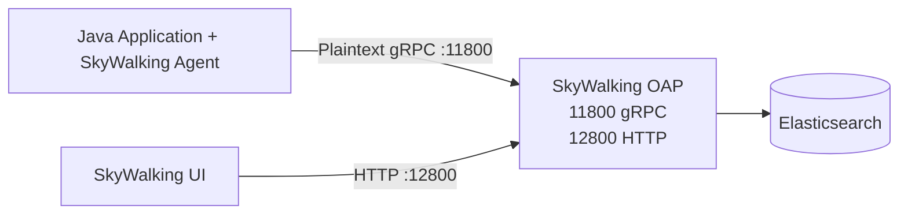

# 2026-10-13

## Today's Focus: Troubleshooting Skywalking Agent Connectivity

## Category: TLS Auto-Detection

### Architecture



### Problem Description

Skywalking UI was accessible but displayed no application traces or metrics

The OAP logs repeatedly reported:

```text
HTTP/2 client preface string missing or corrupt. 
Hex dump for received bytes: 1603...
```

The hexadecimal prefix 16 03 suggested that TLS handshake traffic might have been sent to a plaintext gRPC endpoint.

### Troubleshooting Steps

#### Step 1 - Verify Network Connectivity

Tested TCP connectivity from the application server to OAP:

```bash
nc -vz <OAP_IP> 11800
```

Result: OAP port `11800` is reachable

#### Step 2 - Verify Podman Networking

Checked the OAP container network mode:

```bash
podman inspect skywalking-oap \
  --format '{{.HostConfig.NetworkMode}}'
```

Result:

```text
host
```

Verified the listening ports:

```bash
ss -lntp | grep -E '11800|12800'
```

Result

```text
LISTEN 0 <number> *:11800
LISTEN 0 <number> *:12800
```

**Finding:** OAP was running with host networking, 
and both ports were listening

#### Step 3 - Investigate Agent Logs

The initial Agent logs included messages such as:

```text
Enhance class ... define.ControllerInstrumentation is not activated.
Witness class ... does not exist.
```

These messages indicated that certain instrumentation plugins were not activated because their required classes were unavailable.
But they did not directly explain the gRPC connectivity failure.
To investigate further, DEBUG logging was enabled for the Agent

```properties
logging.level=DEBUG
```

The DEGUG logs revealed repeated disconnection messages:

```text
SkywalkingAgent-11-ConfigurationDiscoveryService-0
ConfigurationDiscoveryService ... status: DISCONNECT

SkywalkingAgent-7-ServiceManagementClient-0
ServiceManagementClient ... status: DISCONNECT
```

Additional logs indicated gRPC reconnection activity

**Finding**: The Agent was unable to maintain normal communication
with OAP, suggesting a transport-level or protocol-level issue

#### Step 4 - Investigate TLS Configuration

Structure of Agent artifact:

```text
skywalking-agent/
├── skywalking-agent.jar
├── config/
│   └── agent.config
└── ca/
    └── ca.crt
```

The certificate had been packaged for an environment that required TLS,
the current did not use the CA certificate.

However, SkyWalking Java Agent supports automatic TLS activation when a CA certificate 
is detected in its configured certificate path.

**Finding**: The existing CA certificate caused the Agent to use TLS 
while OAP expected plaintext gRPC.

### Resolution

1. Removed the unused CA certificate directory from the Agent artifact
2. Explicitly disabled TLS:

```properties
agent.enable_tls=false
```

After restarting the application:

- Agent-to-OAP gRPC connectivity was restored
- Skywalking UI successfully displayed application monitoring data
- Application traces and metrics became available


### Root Cause

The deployment artifact contained an environment-specific CA certificate 
that was not required in the current environment.

The SkyWalking Agent detected the certificate and attempted TLS communication 
with OAP.

However, the OAP gRPC endpoint was configured for plaintext communication.

This protocol mismatch resulted in HTTP/2 initialization errors and prevented 
the Agent from successfully reporting monitoring data.

### Lessons Learned

- **CA certificates can affect Agent connection behavior.** Skywalking Java
Agent supports automatic TLS activation based on certificate detection.


- **TCP connectivity does not guarantee gRPC connectivity.** Network and 
application protocols must be validated separately.


- TLS configuration must match on both sides. A TLS-enabled Agent cannot communicate successfully with an OAP endpoint expecting plaintext gRPC.

### Reference

Apache SkyWalking — Support Transport Layer Security (TLS)

https://skywalking.apache.org/docs/skywalking-java/v9.5.0/en/setup/service-agent/java-agent/tls/
