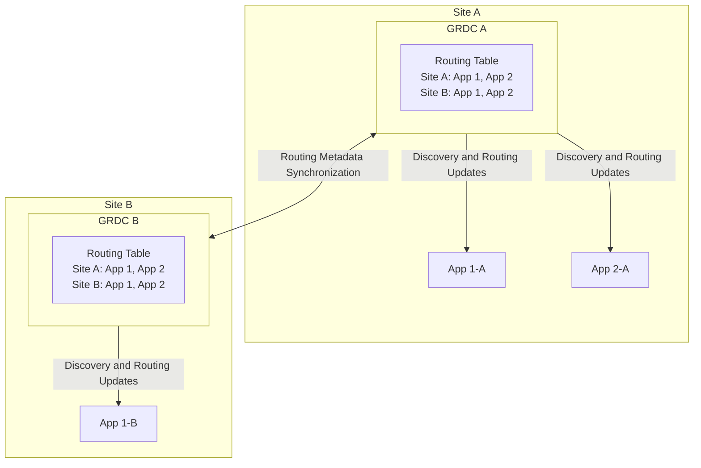
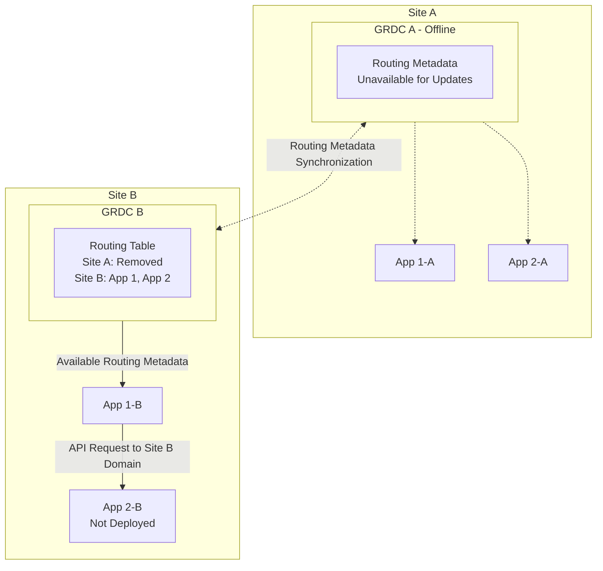

# 2026-10-14

## Today's Focus: Multi-Site Service Routing and High Availability

## Category: Service Discovery / Routing Consistency / Disaster Recovery

### Architecture Overview

#### Data Center Management

The management platform provides a **Data Center Management** module 
that allows administrators to configure domain prefixes for different sites.

For example:

| Site   | Domain Prefix  |
|--------|----------------|
| Site A | `xxx-site-a-`  |
| Site B | `xxx-site-b-`  |

For applications integrated through the cloud platform, the routing mechanism 
uses these prefixes to construct site-specific service domains.

For example, App 1 can have the following routing entries:

| Application   | Site A Domain     | Site B Domain     |
|---------------|-------------------|-------------------|
| App 1         | `xxx-site-a-app1` | `xxx-site-b-app1` |
| App 2         | `xxx-site-a-app2` | `xxx-site-b-app2` |

These are illustrative domain names rather than actual infrastructure addresses.

#### Cloud Application Routing

Applications integrated with the management platform are identified by a `cloud` flag 
in the routing metadata.

For a cloud application, the routing mechanism generates entries for both configured sites.

**Important:** The presence of a generated routing entry does not necessarily mean 
that the application has been deployed at that site.

For example, even if `App 2` is deployed only in `Site A`, its routing metadata 
may still contain a `Site B` domain.

#### Architecture Diagram



In this example:

- App 1 is deployed in both sites.
- App 2 is deployed only in Site A.
- Both GRDC routing tables contain generated routing entries for
  App 1 and App 2 in both sites.
- Applications use routing information obtained from GRDC to resolve
  target service domains.


### Problem Description

During an infrastructure maintenance operation, GRDC A became unavailable.

Under the existing routing mechanism, when a site's GRDC instance went offline, 
the routing metadata associated with that site was removed from the routing tables.

As a result, GRDC B no longer retained the Site A routing information.

However, App 2 was deployed only in Site A. Its Site B domain existed in the 
routing metadata because of the cloud routing generation mechanism, but there 
was no corresponding App 2 deployment in Site B.

When App 1-B initiated a cross-system API call to App 2, the available routing 
information led to the Site B domain.

The resulting request targeted a domain without an available App 2 service, 
causing the API call to fail.

#### Architecture During the Failure



### Troubleshooting Steps

#### Step 1 - Analyze API Call Logs

The API call logs of App 1-B showed that App 1-B attempted to 
invoke App 2 using the following domain:

```text
xxx-site-b-app2
```

However, the request failed because the target service was unavailable.

**Finding**: The API request was directed to the Site B domain of App 2.

#### Step 2 - Verify Application Deployment

Based on the failed request domain, verified that App 2 was not deployed in Site B.

**Finding**: The routing destination did not match the actual application deployment

#### Step 3 - Investigate the Routing Generation Mechanism

Once an application is registered in GRDC, the routing mechanism generated 
site-specific domains using the configured prefixes 
for applications identified by a `cloud` flag

#### Step 4 - Review GRDC Availability and Routing Table Changes

Further investigation revealed that GRDC A had become unavailable during infrastructure maintenance.

Under the existing routing mechanism, when a site's GRDC instance went offline, the corresponding 
site's routing information was removed from the synchronized routing tables.

**Finding**: The GRDC shutdown mechanism removed routing information 
for an entire site without independently verifying the availability of its applications.


### Root Cause

The incident exposed two design weaknesses:

#### 1. Routing Metadata Coupled to GRDC Availability

The existing mechanism treated the unavailability of a site's GRDC service
as a reason to remove all routing information associated with that site.

However, a GRDC outage does not necessarily mean that the applications deployed 
in the same site are unavailable.

Removing the entire site's routing metadata can make otherwise reachable 
application endpoints undiscoverable.

#### 2. Inconsistent Application Deployment Across Sites

The routing table contained a Site B domain for App 2 even though 
no corresponding application deployment existed there because the cloud 
routing mechanism generated entries for both sites

### 5. Resolution and Improvement Plan

#### 5.1 Temporary Workaround - Adjust GRDC Shutdown Sequence

Before the permanent routing changes are implemented, a temporary 
operational workaround is used for planned GRDC maintenance.

When GRDC A requires maintenance, the shutdown sequence is adjusted:

1. Shut down GRDC B first.
2. Allow the existing routing mechanism to remove Site B routing entries.
3. Shut down GRDC A afterward.
4. Preserve the previously obtained Site A routing information for applications that depend on Site A endpoints.

Under the current routing removal mechanism, this sequence is intended to prevent 
applications from selecting generated Site B endpoints for services that are deployed only in Site A.

**Limitations and Risks**:

- It may temporarily reduce or eliminate GRDC service availability.
Routing information may become stale while GRDC services are unavailable.
- The workaround does not provide application-level failover.
- This is an operational mitigation rather than a permanent architectural solution.

#### 5.2 Long-Term Solution

1. Require Dual-Site Application Deployment
   - Applications integrated through the cloud platform should be deployed in both sites to support failover.

2. Decouple Routing Metadata from GRDC Availability

   - Modify the GRDC routing removal mechanism so that shutting down a single GRDC instance does not automatically 
   remove the entire site's routing information.
   - When GRDC A becomes unavailable, GRDC B retains the last synchronized Site A routing metadata. 
   Existing Site A endpoints remain discoverable.

### Lessons Learned

#### Why did the routing mechanism provide a Site B domain for an application that was deployed only in Site A?

The original routing design assumed that cloud applications were deployed across both data centers and did not 
account for single-site deployments. As a result, the routing mechanism automatically generated endpoints for both sites, 
even when an application was deployed in only one. 

#### How can control-plane failures affect the data plane even when applications maintain local routing tables?

Applications already maintain local routing tables and do not need to query GRDC for every API request. 
However, local routing tables are updated based on routing metadata distributed by GRDC. If a GRDC 
failure triggers the removal of valid routing entries, those changes may propagate to applications and affect subsequent 
API calls.A temporary control-plane outage should preserve the last known routing metadata rather than trigger site-wide route removal. 
