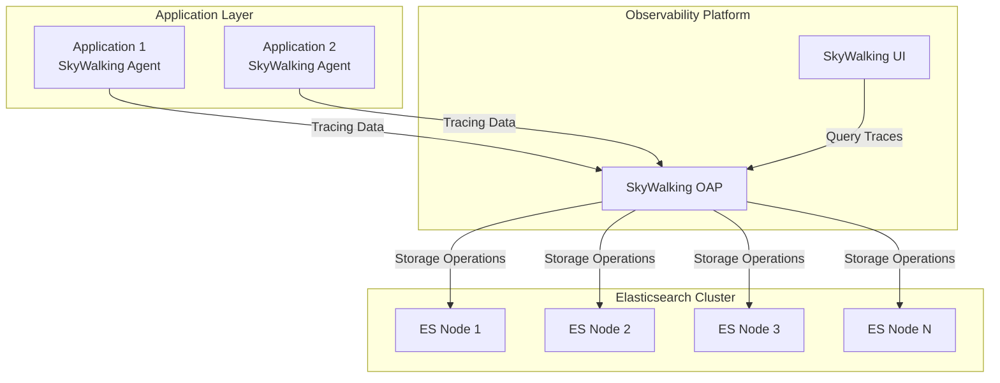

# 2026-10-15

## Today's Focus: Troubleshooting Missing SkyWalking Traces After an Elasticsearch Version Mismatch

## Category: SkyWalking / Elasticsearch / Production Troubleshooting

### Architecture Overview

The Elasticsearch cluster runs on Linux servers and serves as the storage backend for SkyWalking OAP.



### Problem Description

The SkyWalking UI was no longer displaying distributed tracing data, while Service 
Monitoring, Instance Monitoring, Endpoint Monitoring, and Topology were still displaying data.
Approximately one month earlier, the Linux servers hosting
the Elasticsearch cluster had undergone an OS upgrade using:

```bash
yum update
```

No immediate application-level issues were observed on the day after the OS upgrad.
However, when the SkyWalking platform was checked approximately one month later,
distributed tracing data was unavailable.

The investigation identified two related issues:

1. Inconsistent Elasticsearch versions across cluster nodes.
2. Missing SkyWalking static indices after Elasticsearch data cleanup and version recovery.

### Troubleshooting Steps

#### Step 1 - Check Elasticsearch Services and Logs

**Check Elasticsearch service status:**

```bash
systemctl status elasticsearch
```

**Finding:** All Elasticsearch services were `active (running)`.

**Check cluster nodes:**

List cluster nodes:

```bash
curl --user USER:PASSWORD -k https://ES_IP:PORT/_cat/nodes?v
```

**Finding:** Unable to retrieve cluster node information despite successful network connectivity.

Check Elasticsearch logs:

```bash
tail -500 skywalking.log
```

**Finding:** Elasticsearch processes were running, but cluster functionality was not confirmed.

#### Step 2 - Check Elasticsearch Versions

**Check the installed Elasticsearch version on each node:**

```bash
rpm -q elasticsearch
yum list installed elasticsearch
```

**Finding:** Some nodes were running Elasticsearch 7.x, while others had been updated to 8.x.

Reviewed the `yum update` operation had therefore introduced introduced 
inconsistent versions because of the nodes used different repo

#### Step 3 - Restart ES Nodes

Elasticsearch nodes were restarted sequentially, but SkyWalking functionality was not restored.

#### Step 4 - Restore ES 7.x

Since ES 8.x had not been validated for the existing environment, the Elasticsearch nodes 
were restored to a consistent ES 7.x version. The existing ES data was cleared.

After restarting SkyWalking, the UI still displayed no Trace Data

#### Step 5 - Check SkyWalking OAP Logs

The logs reported `no such index` errors involving static indices without date suffixes.

Further investigation found that SkyWalking OAP had remained running during the Elasticsearch data cleanup and version modify. 
Required indices had been deleted but were not successfully recreated.

### Root Cause

#### 1. Inconsistent Elasticsearch Versions

Different Yum repository configurations caused Elasticsearch nodes to receive different 
major versions during the Linux OS upgrade. Elasticsearch 7.x and 8.x can coexist temporarily 
during supported rolling upgrades, but mixed-version deployments are not supported for long-term operation.

#### 2. Incomplete Storage Reinitialization

Elasticsearch data was cleared while SkyWalking OAP was still running, leaving required static indices missing. 
Restarting OAP alone did not restore them.

### Resolution

The issue was resolved through the following procedure:

1. Standardized all Elasticsearch nodes to the approved 7.x release.
   (Rebuilt Elasticsearch with version 7.x instead of downgrading directly from 8.x.)
2. Stopped SkyWalking OAP.
3. Cleaned up the affected Elasticsearch indices and templates.

```bash
curl --user USER:PASSWORD -k https://ES_IP:PORT/_cat/indices
curl -XDELETE --user USER:PASSWORD -k https://ES_IP:PORT/INDEX_NAME
curl --user USER:PASSWORD -k https://ES_IP:PORT/_index_template?pretty
curl -XDELETE --user USER:PASSWORD -k https://ES_IP:PORT/_index_template/TEMPLATE_NAME
curl --user USER:PASSWORD -k https://ES_IP:PORT/_cat/aliases?v
```

4. Restarted SkyWalking OAP to reinitialize storage.
5. Verified that the required indices were recreated.
6. Confirmed that new tracing data appeared in the SkyWalking UI.

### Lessons Learned

#### Why didn't restarting Elasticsearch resolve the issue?

Restarting services does not fix version incompatibility.

#### How can similar incidents be prevented?

- Standardize Yum repositories and control middleware package upgrades.

- Validate Elasticsearch node versions before and after OS maintenance.

- Stop dependent services before planned destructive storage cleanup.

- Monitor OAP storage errors and the arrival of new tracing data, not just service availability.
