# 2026-10-23

## Today's Focus: CI With Tekton Pipelines

## Category: CI/CD / Tekton / DevOps

### Background

OCP Pipelines uses Tekton to automate application builds. 
Git webhooks trigger the workflow, which retrieves source code, 
builds the application, and publishes artifacts for delivery

### CI Architecture

```mermaid
flowchart LR
    A["Git Repository"]
    B["Git Webhook"]
    C["Tekton Triggers"]
    D["PipelineRun"]
    E["Tekton Pipeline"]
    F["Task: Git Clone"]
    G["Task: Build & Test"]
    H["Task: Buildah"]
    I["Artifact Repository"]

    A -->|Push / Merge Request| B
    B --> C
    C -->|Create| D
    D -->|Execute| E
    E --> F
    F --> G
    G --> H
    H -->|Push Image| I
```



### Step 1 - EventListener: Receive and Filter Git Events

The EventListener receives Git webhooks. Interceptors check 
the event type and build conditions. Bindings extract parameters,
and `template.ref` selects the TriggerTemplate.

This example accepts GitLab push events when the last commit entry 
contains `trigger sample-app ci`:

```yaml
# File: eventlistener.yaml
apiVersion: triggers.tekton.dev/v1beta1
kind: EventListener
metadata:
  name: application-ci-listener
spec:
  serviceAccountName: pipeline
  triggers:
    - name: application-push
      interceptors:
        - ref:
            name: gitlab
          params:
            - name: eventTypes
              value: ["Push Hook"]
        - ref:
            name: cel
          params:
            - name: filter
              value: >-
                size(body.commits) > 0 &&
                body.commits[size(body.commits) - 1].message.contains("trigger sample-app ci")
      bindings:
        - name: git_url
          value: $(body.project.git_http_url)
        - name: commit_id
          value: $(body.after)
      template:
        ref: application-ci-template
```

**Connection to Step 2:** `template.ref` matches 
the TriggerTemplate's `metadata.name`

### Step 2 - TriggerTemplate: Create a PipelineRun

The TriggerTemplate receives the bound parameters 
and defines the PipelineRun to create:

```yaml
# File: triggertemplate.yaml
apiVersion: triggers.tekton.dev/v1beta1
kind: TriggerTemplate
metadata:
  name: application-ci-template
spec:
  params:
    - name: git_url
    - name: commit_id
  resourcetemplates:
    - apiVersion: tekton.dev/v1
      kind: PipelineRun
      metadata:
        generateName: application-ci-run-
      spec:
        pipelineRef:
          name: application-ci
        params:
          - name: git_url
            value: $(tt.params.git_url)
          - name: commit_id
            value: $(tt.params.commit_id)
```

**Connection to Step 3:** `pipelineRef.name` matches the 
Pipeline's `metadata.name`. The generated run supplies the 
repository URL and commit ID.

### Step 3 - Pipeline: Select Tasks and Define Their Order

The Pipeline declares inputs, references reusable Tasks, 
and passes parameters to them:

```yaml
# File: pipeline.yaml
apiVersion: tekton.dev/v1
kind: Pipeline
metadata:
  name: application-ci
spec:
  params:
    - name: git_url
      type: string
    - name: commit_id
      type: string
  tasks:
    - name: clone
      taskRef:
        name: git-clone
      params:
        - name: url
          value: $(params.git_url)
        - name: revision
          value: $(params.commit_id)

    - name: build
      runAfter:
        - clone
      taskRef:
        name: maven-build
      params:
        - name: GOALS
          value:
            - clean
            - package
            - "-Dmaven.test.skip=true"

    - name: publish-image
      runAfter:
        - build
      taskRef:
        name: buildah
      params:
        - name: IMAGE
          value: registry.example.com/team/sample-app:$(params.commit_id)
        - name: DOCKERFILE
          value: Dockerfile
        - name: CONTEXT
          value: "."
```

`runAfter` uses names within the Pipeline: `clone`, `build`, 
and `publish-image`. 
`taskRef.name` identifies the separate Task definition.

**Connection to Step 4:** the three Task references match the 
resource names in the Task files below.

### Step 4 - Tasks: Execute Commands and Publish the Image

Each Task file defines executable steps and the parameters they accept.

| Task resource name   | Role in this workflow                                         |
|----------------------|---------------------------------------------------------------|
| `git-clone`          | Retrieve the repository at the supplied revision.             |
| `maven-build`        | Run Maven with the supplied goals.                            |
| `buildah`            | Build from the Dockerfile and push the image to the registry. |

Example:

```yaml
# File: maven-build-task.yaml
apiVersion: tekton.dev/v1
kind: Task
metadata:
  name: maven-build
spec:
  params:
    - name: GOALS
      type: array
  workspaces:
    - name: source
  steps:
    - name: package
      image: maven:3.9-eclipse-temurin-17
      workingDir: $(workspaces.source.path)
      command:
        - mvn
      args:
        - "$(params.GOALS[*])"
```

### Step 5 - PipelineRun and TaskRun: Verify Execution

The PipelineRun represents the overall execution. Tekton creates 
TaskRuns for the tasks that execute.

- Check the PipelineRun status and input parameters
- Review TaskRun logs for source retrieval, build, and push results
- Confirm the image exists in the registry with the expected tag

The published image is then available for the CD workflow.
