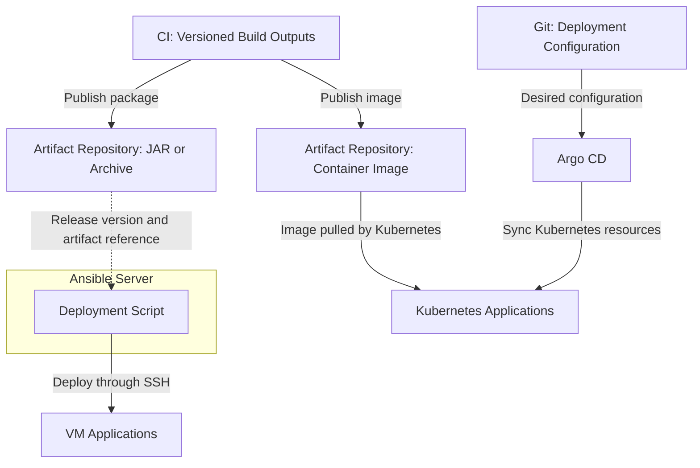

# 2026-10-25

## Today's Focus: CD for Kubernetes and VM Applications

## Category: CI/CD / Argo CD / Ansible

### Background

Application deployment follows two paths. Kubernetes applications 
use Argo CD to synchronize deployment configuration from a dedicated 
Git repository. VM applications are deployed from an Ansible server 
using a deployment script that connects to the target servers over SSH.

### CD Architecture



## Deploy Kubernetes Applications with Argo CD

### Step 1 - Update the Kubernetes Deployment Configuration

Update the image reference in the deployment configuration 
repository and commit the change:

```yaml
# File: demo/deployment.yaml
apiVersion: apps/v1
kind: Deployment
metadata:
  name: demo-app
spec:
  replicas: 2
  selector:
    matchLabels:
      app: demo-app
  template:
    metadata:
      labels:
        app: demo-app
    spec:
      containers:
        - name: demo-app
          image: registry.example.com/demo/app:1.0.0
```

### Step 2 - Connect Argo CD to the Configuration Repository

The Argo CD `Application` identifies the Git source and deployment 
destination. This mapping is normally created during onboarding and 
reused for subsequent releases:

```yaml
# File: argocd/demo-app.yaml
apiVersion: argoproj.io/v1alpha1
kind: Application
metadata:
  name: demo-app
  namespace: argocd
spec:
  project: default
  source:
    repoURL: https://git.example.com/demo/deployment-config.git
    targetRevision: main
    path: demo
  destination:
    server: https://kubernetes.default.svc
    namespace: demo
```

**Connection to Step 1** `source.path: demo` points to the directory containing 
the manifest from Step 1

### Step 3 - Synchronize and Roll Out the Kubernetes Application

- Argo CD compares the Git configuration with the live cluster state
- Synchronization applies the required resource changes
- Kubernetes pulls the selected image and manages the workload rollout

Synchronization can be manual or automatic, depending on policy

### Step 4 - Verify the Deployment and Record the Result

Check Argo CD sync status, workload health, Pod readiness, and the 
deployed image version. Review application logs and run basic functional smoke tests.

If verification fails, restore the previous image reference and relevant configuration in Git, then synchronize.

## Deploy VM applications from an Ansible server

### Step 1 - Download the VM Release

Run the deployment script from the Ansible server with the selected 
release and target servers

- Download the selected JAR or archive to the designated 
deployment directory on the target servers
- Verify the artifact version and integrity before stopping services
- Prepare the required environment configuration and retain the previous release 
for rollback

### Step 2 - Define the VM Service Sequence

The deployment script reads `sequence.yml` to determine the 
stop/start order and the corresponding scripts

```yaml
# File: sequence.yml
stop:
  - service: service-b
    script: /opt/demo/service-b/bin/stop.sh
  - service: service-a
    script: /opt/demo/service-a/bin/stop.sh

start:
  - service: service-a
    script: /opt/demo/service-a/bin/start.sh
  - service: service-b
    script: /opt/demo/service-b/bin/start.sh
```

### Step 3 - Install the Release and Restart Services

The deployment script coordinates the following actions over SSH:

1. Read the `stop` list from Step 2 and invoke each script on its 
corresponding target server
2. Confirm that the affected services have stopped
3. Install the downloaded artifacts from Step 1 and apply the release configuration
4. Read the `start` list and invoke the startup scripts in order
5. Confirm that each required dependency is ready before starting the service that depends on it

Stop the deployment if a required operation fails and record the failed step. 
A successful script exit alone does not confirm application health.

### Step 4 - Verify the Deployment and Record the Result

Check deployment script results, service status, health check results, 
and the installed version. Review application logs and run basic 
functional smoke tests.

If verification fails, restore the previous package and configuration using the required stop/start sequence.
