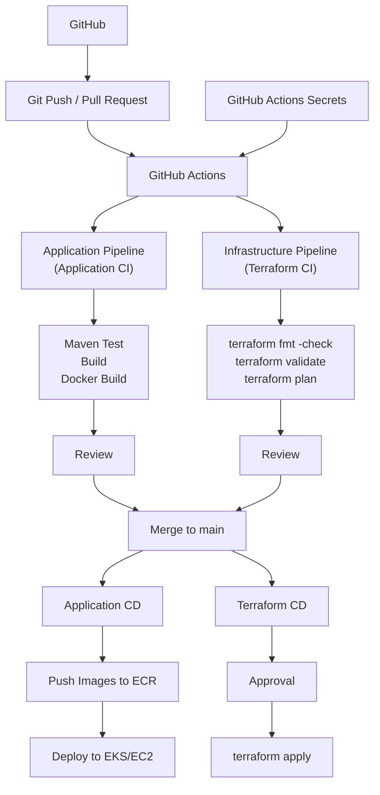

# 2026-11-01

## Today's Focus: Implement CI/CD in management-platform

## CI/CD Architecture



## Deploy management-platform Using CI/CD

## 1. Preparation Before Deployment

### 1.1 Import the Project

Import `management-platform.zip` in AWS CloudShell

Unzip the project

```bash
unzip management-platform.zip
```

Check the project

```bash
ls management-platform
```

Expected result
```text
README.md               docs          global-lb     management-plane        platform-common    
application-plane       gateway       grdc          terraform               pom.xml
```
### 1.2 Tool Requirements

Check the version of tools

```bash
aws --version
terraform version
docker version
docker info
docker buildx version
kubectl version --client
helm version
jq --version
python3 --version
session-manager-plugin --version
```

Expected result: every command succeeds; `docker version` includes both Client and Server.

| Tool                   | Requirement                                          | Purpose                                      |
|------------------------|------------------------------------------------------|----------------------------------------------|
| AWS CLI                | v2                                                   | AWS APIs, EKS access, SSM                    |
| Terraform              | >=1.10.0 and <2.0.0                                  | Matches the supplied `terraform/versions.tf` |
| Docker + buildx        | Working daemon; linux/amd64 build support            | Build six images and extract App2 JAR        |
| kubectl                | Match the configured EKS minor version; example 1.35 | Apply and verify Kubernetes resources        |
| Helm                   | v3                                                   | Install AWS Load Balancer Controller         |
| jq                     | 1.6 or later                                         | Read Terraform outputs                       |
| Python                 | 3.9 or later                                         | Deployment helper scripts                    |
| Session Manager plugin | Installed                                            | SSH/SCP over SSM to private App2 hosts       |

### 1.3 Configure AWS Identity and Region

Create a user named `management-admin` in AWS IAM Identity Center. Assign
the user access to the target AWS account with the `AdministratorAccess`
permission set for this lab, then configure the AWS CLI SSO profile

```bash
aws configure sso --profile management-admin 
export AWS_PROFILE=management-admin
```

Check AWS identity

```bash
aws sts get-caller-identity
```
Expected result

```json
{
  "UserId": "...",
  "Account": "...",
  "Arn": "arn:aws:iam::..."
}
```

Set the region:

```bash
export AWS_REGION=us-east-1
export AWS_DEFAULT_REGION="$AWS_REGION"
export AWS_PAGER=""
```


