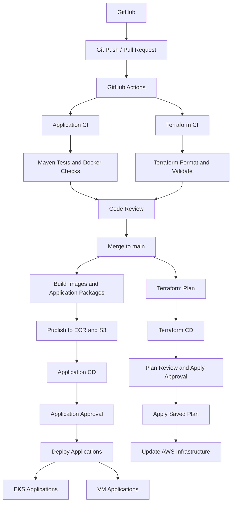

# 2026-11-04

## Today's Focus: Implement CI/CD in management-platform

## CI/CD Architecture



## Deploy management-platform Using CI/CD

## 1. Preparation Before Deployment

### 1.1 Import the Project

Import `management-platform.zip`

Unzip the project

```bash
unzip management-platform.zip
```

Check the project

```bash
ls -la management-platform
```

Expected result
```text
README.md               docs          global-lb     management-plane        platform-common    
application-plane       gateway       grdc          terraform               pom.xml
.dockerignore           .gitignore  
```
### 1.2 Tool Requirements

Check the version of tools

```bash
aws --version
terraform version
kubectl version --client
helm version
jq --version
python3 --version
session-manager-plugin --version
gh --version
git --version
```

Expected result: every command succeeds;

| Tool                   | Requirement                                          | Purpose                                                             |
|------------------------|------------------------------------------------------|---------------------------------------------------------------------|
| AWS CLI                | v2                                                   | AWS APIs, EKS access, SSM                                           |
| Terraform              | >=1.10.0 and <2.0.0                                  | Matches the supplied `terraform/versions.tf`                        |
| kubectl                | Match the configured EKS minor version; example 1.35 | Apply and verify Kubernetes resources                               |
| Helm                   | v3                                                   | Install AWS Load Balancer Controller                                |
| jq                     | 1.6 or later                                         | Read Terraform outputs                                              |
| Python                 | 3.9 or later                                         | Deployment helper scripts                                           |
| Session Manager plugin | Installed                                            | SSH/SCP over SSM to private App2 hosts                              |
| GitHub CLI (gh)        | Current stable 2.x recommended                       | Performs GitHub login, PR, GitHub Actions                           |
| Git                    | v2.x                                                 | Manage Git repositories, commits, branches and push/pull operations |

### 1.3 Authenticate Locally

Create a user named `management-admin` in AWS IAM Identity Center. Assign
the user access to the target AWS account with the `AdministratorAccess`
permission set for this lab, then configure the AWS CLI SSO profile

```bash
aws configure sso --profile management-admin 
export AWS_PROFILE=management-admin
```

Check AWS identity

```bash
aws sts get-caller-identity
```

Expected result

```json
{
  "UserId": "...",
  "Account": "...",
  "Arn": "arn:aws:iam::..."
}
```

Run

```bash
export AWS_REGION=us-east-1
export AWS_DEFAULT_REGION="$AWS_REGION"
export AWS_PAGER=""
export AWS_DEFAULT_OUTPUT=json
export AWS_PROFILE=management-admin
gh auth login
gh auth status
```

Expected result

```text
github.com
  ✓ Logged in to github.com account ... (keyring)
  - Active account: true
  - Git operations protocol: https
  - Token: ...
  - Token scopes: ...
```

### 1.4 Prepare the Python Environment

Run

```bash
python3 -m venv .venv
source .venv/bin/activate
python3 -m pip install PyYAML==6.0.3 bcrypt==4.3.0 python-hcl2==7.3.1
```

Expected result

```text
Successfully built PyYAML
Installing collected packages: PyYAML, bcrypt， python-hcl2
Successfully installed PyYAML-6.0.3 bcrypt-4.3.0 python-hcl2-7.3.1
```

### 1.5 Verify Git Really the Private Files

```bash
git check-ignore -v \
  .ha-work/runtime.json .cicd-work/variables.json \
  terraform/backend.hcl terraform/ci.auto.tfvars.json terraform/cleanup.auto.tfvars
```

Expected result

```text
PROJECT/AWS/management-platform/.gitignore:8:.ha-work/  .ha-work/runtime.json
PROJECT/AWS/management-platform/.gitignore:9:.cicd-work/        .cicd-work/variables.json
PROJECT/AWS/management-platform/.gitignore:13:**/backend.hcl    terraform/backend.hcl
PROJECT/AWS/management-platform/.gitignore:22:**/ci.auto.tfvars.json    terraform/ci.auto.tfvars.json
PROJECT/AWS/management-platform/.gitignore:23:**/cleanup.auto.tfvars    terraform/cleanup.auto.tfvars
```

## 2. Run One-Time Setup

One-time setup scrip `setup-cicd.py` provisions:

- VPC, subnets, NAT gateways and security groups
- ALB and NLB
- RDS Oracle and supporting data services
- ECR repositories
- EKS cluster and node groups
- EC2 application and Elasticsearch hosts
- The private CodeBuild deployment runner

Run

```bash
python3 docs/scripts/setup-cicd.py configure --new-environment --solo
```

Expected result

```text
SETUP COMPLETE. GitHub configuration and Terraform backends are ready.
```

Push `.terraform.lock.hcl` to git

## 3. Check GitHub Configuration

Run

```bash
gh secret list
gh variable list
```

Expected secret names

```text
AWS_ACCOUNT_ID
TF_STATE_BUCKET
TF_STATE_KEY
TF_VARS_JSON
ARTIFACT_BUCKET
AWS_PLAN_ROLE_ARN
AWS_APPLY_ROLE_ARN
AWS_BUILD_ROLE_ARN
AWS_DEPLOY_ROLE_ARN
```

Expected non-sensitive variables

```text
AWS_REGION
CODEBUILD_PROJECT
INFRA_ENABLED
INFRA_APPLY_ENABLED
PUBLISH_ENABLED
DEPLOY_ENABLED
```

## 4. Open the First PR

Run

```bash
git switch -c management-platform-cicd
git add .
git status --short
git diff --cached --stat
git commit -m "First management-platform CI/CD deployment[deploy]"
git push -u origin management-platform-cicd

gh pr create \
  --base main \
  --head management-platform-cicd \
  --title "First management-platform CI/CD deployment[deploy]" \
  --body "First management-platform CI/CD deployment[deploy]"
```

## 5. Verify PR CI

Run

```bash
gh pr checks
gh run list --limit 5
```

Expected result

```text
checks       pass
validate     pass
plan         pass or skipped
```

## 6. Review and Merge the First PR

Run

```bash
gh pr merge --squash \
  --delete-branch \
  --subject "First management-platform CI/CD deployment [deploy]"
  
gh run list --limit 5
```

Expected result

```text
Success
```

## 7. Deploy Infrastructure and Applications

### 7.1 Verify Terraform CD

Run

```bash
gh run list --branch main --limit 10
gh run view <RUN_ID>
```

Expected result

```text
Apply complete! Resources: ... added, ... changed, ... destroyed.
```

### 7.2 Verify Application Build and Artifact Publishing

Run

```bash
gh run list --branch main --limit 10
gh run view <RUN_ID>
```

Expected result

```text
Maven build successful.
Docker images built.
Docker images pushed to Amazon ECR.
Application packages published to Amazon S3.
```

Check ECR repositories

```bash
aws ecr describe-repositories \
  --query 'repositories[].repositoryName' \
  --output table
```

Expected result

```text
ECR repositories for management-platform are listed
```

Check S3 artifact bucket

```bash
aws s3 ls s3://<ARTIFACT_BUCKET_NAME>/
```

Expected result

```text
Application packages are available in S3.
```

