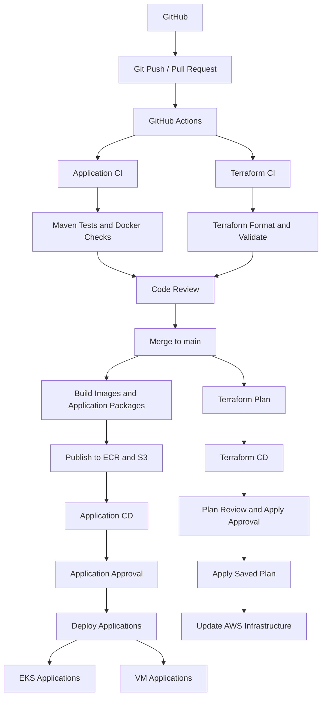

# 2026-11-08

## Today's Focus: Implement CI/CD in management-platform

## CI/CD Architecture



## Deploy management-platform Using CI/CD

## 1. Preparation Before Deployment

### 1.1 Import the Project

Import `management-platform.zip`

Unzip the project

```bash
unzip management-platform.zip
```

Check the project

```bash
ls -la management-platform
```

Expected result
```text
README.md               docs          global-lb     management-plane        platform-common    
application-plane       gateway       grdc          terraform               pom.xml
.dockerignore           .gitignore  
```
### 1.2 Tool Requirements

Check the version of tools

```bash
aws --version
terraform version
kubectl version --client
helm version
jq --version
python3 --version
session-manager-plugin --version
gh --version
git --version
```

Expected result: every command succeeds;

| Tool                   | Requirement                                          | Purpose                                                             |
|------------------------|------------------------------------------------------|---------------------------------------------------------------------|
| AWS CLI                | v2                                                   | AWS APIs, EKS access, SSM                                           |
| Terraform              | >=1.10.0 and <2.0.0                                  | Matches the supplied `terraform/versions.tf`                        |
| kubectl                | Match the configured EKS minor version; example 1.35 | Apply and verify Kubernetes resources                               |
| Helm                   | v3                                                   | Install AWS Load Balancer Controller                                |
| jq                     | 1.6 or later                                         | Read Terraform outputs                                              |
| Python                 | 3.9 or later                                         | Deployment helper scripts                                           |
| Session Manager plugin | Installed                                            | SSH/SCP over SSM to private App2 hosts                              |
| GitHub CLI (gh)        | Current stable 2.x recommended                       | Performs GitHub login, PR, GitHub Actions                           |
| Git                    | v2.x                                                 | Manage Git repositories, commits, branches and push/pull operations |

### 1.3 Authenticate Locally

Create a user named `management-admin` in AWS IAM Identity Center. Assign
the user access to the target AWS account with the `AdministratorAccess`
permission set for this lab, then configure the AWS CLI SSO profile

```bash
aws configure sso --profile management-admin 
export AWS_PROFILE=management-admin
```

Check AWS identity

```bash
aws sts get-caller-identity
```

Expected result

```json
{
  "UserId": "...",
  "Account": "...",
  "Arn": "arn:aws:iam::..."
}
```

Run

```bash
export AWS_REGION=us-east-1
export AWS_DEFAULT_REGION="$AWS_REGION"
export AWS_PAGER=""
export AWS_DEFAULT_OUTPUT=json
export AWS_PROFILE=management-admin
gh auth login
gh auth status
```

Expected result

```text
github.com
  ✓ Logged in to github.com account ... (keyring)
  - Active account: true
  - Git operations protocol: https
  - Token: ...
  - Token scopes: ...
```

### 1.4 Prepare the Python Environment

Run

```bash
python3 -m venv .venv
source .venv/bin/activate
python3 -m pip install PyYAML==6.0.3 bcrypt==4.3.0 python-hcl2==7.3.1
```

Expected result

```text
Successfully built PyYAML
Installing collected packages: PyYAML, bcrypt， python-hcl2
Successfully installed PyYAML-6.0.3 bcrypt-4.3.0 python-hcl2-7.3.1
```

### 1.5 Verify Git Really the Private Files

```bash
git check-ignore -v \
  .ha-work/runtime.json .cicd-work/variables.json \
  terraform/backend.hcl terraform/ci.auto.tfvars.json terraform/cleanup.auto.tfvars
```

Expected result

```text
PROJECT/AWS/management-platform/.gitignore:8:.ha-work/  .ha-work/runtime.json
PROJECT/AWS/management-platform/.gitignore:9:.cicd-work/        .cicd-work/variables.json
PROJECT/AWS/management-platform/.gitignore:13:**/backend.hcl    terraform/backend.hcl
PROJECT/AWS/management-platform/.gitignore:22:**/ci.auto.tfvars.json    terraform/ci.auto.tfvars.json
PROJECT/AWS/management-platform/.gitignore:23:**/cleanup.auto.tfvars    terraform/cleanup.auto.tfvars
```

## 2. Open the First PR

Run

```bash
git switch -c management-platform-cicd
git add .
git status --short
git diff --cached --stat
git commit -m "First management-platform CI/CD deployment[deploy]"
git push -u origin management-platform-cicd

gh pr create \
  --base main \
  --head management-platform-cicd \
  --title "First management-platform CI/CD deployment[deploy]" \
  --body "First management-platform CI/CD deployment[deploy]"
```

## 3. Verify PR CI

Run

```bash
gh pr checks
gh run list --limit 5
```

Expected result

```text
checks       pass
validate     pass
plan         pass or skipped
```

## 4. Review and Merge the First PR

Run

```bash
gh pr merge --squash \
  --delete-branch \
  --subject "First management-platform CI/CD deployment [deploy]"
  
gh run list --limit 5
```

Expected result

```text
Success
```

## 5. Run One-Time Setup

One-time setup scrip `setup-cicd.py` provisions:

- VPC, subnets, NAT gateways and security groups
- ALB and NLB
- RDS Oracle and supporting data services
- ECR repositories
- EKS cluster and node groups
- EC2 application and Elasticsearch hosts
- The private CodeBuild deployment runner

Run

```bash
python3 docs/scripts/setup-cicd.py configure --new-environment --solo
```

Expected result

```text
SETUP COMPLETE. GitHub configuration and Terraform backends are ready.
```

Push `.terraform.lock.hcl` to git

## 6. Check GitHub Configuration

Run

```bash
gh secret list
gh variable list
```

Expected secret names

```text
AWS_ACCOUNT_ID
TF_STATE_BUCKET
TF_STATE_KEY
TF_VARS_JSON
ARTIFACT_BUCKET
AWS_PLAN_ROLE_ARN
AWS_APPLY_ROLE_ARN
AWS_BUILD_ROLE_ARN
AWS_DEPLOY_ROLE_ARN
```

Expected non-sensitive variables

```text
AWS_REGION
CODEBUILD_PROJECT
INFRA_ENABLED
INFRA_APPLY_ENABLED
PUBLISH_ENABLED
DEPLOY_ENABLED
```

## 7. First Infrastructure Deployment

### 7.1 Trigger Terraform Plan and Apply on main

```bash
gh workflow run management-platform.yml \
  --ref main \
  -f target=infrastructure \
  -f apply=true

gh run list --workflow management-platform.yml --branch main --limit 10
```

Expected result: 

A `workflow_dispatch` run starts. The `changes` job selects infrastructure, 
then `checks`, `validate`, `plan` and (after approval) `apply` execute. 
The `plan` job saves a Terraform plan to the artifact bucket. Application publish/deploy are not yet enabled.

### 7.2 Approve Terraform Apply

Open the run in GitHub Actions and approve the `aws-terraform-apply` 
environment request. Then inspect:

```bash
gh run view <RUN_ID>
gh run view <RUN_ID> --log
```

Expected result

```text
plan       success
apply      success
Apply complete! Resources: ... added, ... changed, ... destroyed.
```

## 8. Initialize Platform Runtime (One Time)

### 8.1 Verify Infrastructure and Private Hosts

Run

```bash
aws eks list-clusters --region "$AWS_REGION"
aws ssm describe-instance-information \
  --query 'InstanceInformationList[].[InstanceId,PingStatus,PlatformName]' --output table
aws rds describe-db-instances \
  --query 'DBInstances[].[DBInstanceIdentifier,DBInstanceStatus,MultiAZ]' --output table
```

Expected result:

EKS and RDS exist, RDS is available, and the project App2/Elasticsearch EC2 instances 
become SSM `Online`.

### 8.2 Initialize Runtime Services and Database

Run

```bash
python3 docs/scripts/setup-cicd.py initialize --key <PATH_TO_EXISTING_APP2_PRIVATE_KEY>
```

Expected result

```text
INITIALIZATION COMPLETE. Existing credentials were preserved; normal releases use the workflows.
```

## 9. First Application Release

### 9.1 Trigger the First Full Build and Deployment

Run

```bash
python3 docs/scripts/setup-cicd.py release --first

gh run list --workflow management-platform.yml --branch main --limit 10
```

Expected result

The first release requires all six images and the App2 bundle, 
and empty App2 data volumes may be initialized once only.

### 9.2 Verify CI and Artifact Publishing

Run

```bash
gh run view <RUN_ID>
gh run view <RUN_ID> --log
aws ecr describe-repositories \
  --query 'repositories[].repositoryName' --output table
```

Expected result:

`checks` (Maven verify, Python compile/tests, Docker checks), `validate`, 
and `publish` succeed. `publish` runs a matrix of selected components, 
invokes `build-images.py` and `cicd.py publish`, pushes images to 
ECR and records release artifacts in S3. Expected image components 
from the manual deployment: `management-server`, `gateway`, 
`application-service`, `global-lb`, `grdc`, `rule-sync`.


Check S3 artifact bucket from private `.cicd-work/setup.json`:

```bash
aws s3 ls s3://<ARTIFACT_BUCKET_NAME>/
```

### 9.3 Approve Application Deployment

Run

```bash
gh run view <RUN_ID>
gh run view <RUN_ID> --log
```

Expected result:

`deploy` succeeds and the verified release becomes the current release.

## 10. Post-Deployment Verification

### 10.1 Check EKS and Controllers

Run

```bash
aws eks list-clusters --region "$AWS_REGION"
aws eks update-kubeconfig --name <ACTUAL_EKS_CLUSTER_NAME> --region "$AWS_REGION"
kubectl get nodes -L site,topology.kubernetes.io/zone
kubectl get deploy,ds -A
kubectl get targetgroupbindings -A
kubectl -n observability get pvc
kubectl -n kube-system rollout status deployment/aws-load-balancer-controller --timeout=600s
```

Expected result:

Nodes `Ready`, deployments/daemonsets available, PVCs `Bound`, and TargetGroupBindings present. 
Compare with the old manual deployment's namespaces: `grdc`, `observability`, `platform`, `gateway`, `applications`.

### 10.2 Check RDS, EC2, SSM and RHEL App2

Run

```bash
aws rds describe-db-instances \
  --query 'DBInstances[].[DBInstanceIdentifier,DBInstanceStatus,MultiAZ]' --output table
aws ssm describe-instance-information \
  --query 'InstanceInformationList[].[InstanceId,PingStatus]' --output table
aws ssm start-session --target <APP2_INSTANCE_ID>
```

Inside the App2 host:

```bash
sudo systemctl is-active app2 filebeat-a filebeat-b node-exporter
sudo podman ps
curl -fsS http://127.0.0.1:8080/actuator/health/readiness
findmnt /var/lib/management/app2
exit
``` 

Expected result:

Native App2 is active, supporting Podman containers run, readiness returns `UP`, and App2 data storage is mounted. On each Elasticsearch host, check `systemctl is-active elasticsearch` and `curl -fsS http://127.0.0.1:9200/_cluster/health?pretty`.

### 10.3 Check Load Balancer Targets

Use the actual target group ARNs from Terraform deployment output or AWS inventory:

```bash
aws elbv2 describe-target-health --target-group-arn <TARGET_GROUP_ARN> \
  --query 'TargetHealthDescriptions[].{Target:Target.Id,State:TargetHealth.State}' \
  --output table
```

Expected result: 
Relevant target groups have registered `healthy` targets.

## 11. Smoke Test

### 11.1 Log in to the Management Web

Get the URL:

```bash
jq -r .public_url .ha-work/deployment.json
```

Expected result

```text
http://management-platform-lab-public-xxx.us-east-1.elb.amazonaws.com
```

Retrieve the admin password locally

```bash
python3 -c 'import json; print(json.load(open(".ha-work/runtime.json"))["ADMIN_PASSWORD"])'

export MP_BASE_URL="$(jq -r '.public_url' .ha-work/deployment.json)"

export MP_TOKEN="$(
  jq -c '{username:"admin", password:.ADMIN_PASSWORD}' .ha-work/runtime.json |
  curl -fsS \
    -X POST "${MP_BASE_URL}/api/auth/token" \
    -H 'Content-Type: application/json' \
    --data-binary @- |
  jq -er '.access_token // empty'
)"
```

Expected result: the generated password

Open the URL and login

```text
Username: admin
Password: ADMIN_PASSWORD from the runtime secret
```

Expected result: log in successfully

### 11.2 Add a read-only user

#### 11.2.1 Create a read-only user

After logging in via the `admin` account interface, click
`User Manager`, input `username`, `password`, `roles-VIEWER`, `enabled-true`,
Save User

Expected result: You can see the user that was just created at `List users`

#### 11.2.2 Login using the new user

Log in to the web interface using the new user account

Expected result: You can log in to the web interface with the new user account,
but only with read-only access.

### 11.3 API Call

#### 11.3.1 Call API of App1

```bash
curl -sS \
  -H "Authorization: Bearer $MP_TOKEN" \
  -w '\nHTTP status: %{http_code}\n' \
  "${MP_BASE_URL}/api/app1/hello"
```

Expected result

```text
{"message":"hello from management-platform","service":"app1","instance":"app1-a-xxx,"site":"a"}
HTTP status: 200
```

### 11.3.2 Call API of App2

```bash
curl -sS \
  -H "Authorization: Bearer $MP_TOKEN" \
  -w '\nHTTP status: %{http_code}\n' \
  "${MP_BASE_URL}/api/app2/hello"
```

```text
{"service":"app2","instance":"i-xxx","site":"a","message":"hello from management-platform"}
HTTP status: 200
```

#### 11.3.3 App1 call App2

```bash
curl -sS \
  -H "Authorization: Bearer $MP_TOKEN" \
  -w '\nHTTP status: %{http_code}\n' \
  "${MP_BASE_URL}/api/app1/call/app2"
```

Expected result

```text
{"target":"app2","caller":"app1","body":"{\"service\":\"app2\",\"instance\":\"i-xxx\",\"site\":\"a\",\"message\":\"hello from management-platform\"}","selectedSite":"b","callerSite":"b"}
HTTP status: 200
```

### 11.4 Monitoring, Logging, and Tracing

#### 11.4.1 Monitoring-Observability

Click `Observability` in web interface, then click `Run query`

Expected result

```text
metric	value	timestamp
{"__name__":"up","instance":<internalIP>,"job":"rhel-nodes","site":"b"}	1	1791814085.567
{"__name__":"up","instance":<internalIP>,"job":"app2","site":"a"}	1	1791814085.567
```

Then run the following query

```bash
node_memory_MemAvailable_bytes
```

Expected result

```text
metric	value	timestamp
{"__name__":"node_memory_MemAvailable_bytes","instance":<InternalIP>,"job":"rhel-nodes","site":"a"}	737681412	1791814206.833
{"__name__":"node_memory_MemAvailable_bytes","instance":<InternalIP>,"job":"rhel-nodes","site":"b"} 741752812	1791814206.833
```

#### 11.4.2 Logging

Click `Log Manager` in Web, then click `Search last 24 hours`

Expected result

```text
2026-10-12T14:11:24.181Z			2026-10-12 14:11:24,181 org.apache.skywalking.oap.server.core.storage.ttl.DataTTLKeeperTimer 91 [pool-8-thread-1] INFO [] - Beginning to remove expired metrics from the storage.
```

#### 11.4.3 Tracing

Click `Traffic Manager`, then input

```bash
{
  "query": "query { version }",
  "variables": {}
}
```

Expected result

```text
{
  "data": {
    "version": "10.2.0-a0a00b9"
  }
}
```

### 11.5 Failover

Verify the deployment status of app1

```bash
kubectl get deploy,ds -A | grep app1
```

Expected result

```text
applications    deployment.apps/app1-a                         1/1     1            1           22h
applications    deployment.apps/app1-b                         1/1     1            1           22h
```

Simulate a failure of Site A for App1

```bash
kubectl scale deployment app1-a --replicas=0 -n applications
```

Verify app1-a has stopped

```bash
kubectl get deploy,ds -A | grep app1
```

Expected result

```text
applications    deployment.apps/app1-a                         0/0     0            0           22h
applications    deployment.apps/app1-b                         1/1     1            1           22h
```

Call App1 API again

```bash
curl -sS \
  -H "Authorization: Bearer $MP_TOKEN" \
  -w '\nHTTP status: %{http_code}\n' \
  "${MP_BASE_URL}/api/app1/hello"
```

Expected result

```text
{"message":"hello from management-platform","site":"b","instance":"app1-b-xxx","service":"app1"}
HTTP status: 200
```

App1 call App2

```bash
curl -sS \
  -H "Authorization: Bearer $MP_TOKEN" \
  -w '\nHTTP status: %{http_code}\n' \
  "${MP_BASE_URL}/api/app1/call/app2"
```

Expected result

```text
{"target":"app2","caller":"app1","body":"{\"message\":\"hello from management-platform\",\"site\":\"b\",\"instance\":\"i-xxx\",\"service\":\"app2\"}","selectedSite":"b","callerSite":"b"}
HTTP status: 200
```

## 12. Normal Application Source Change (Subsequent PRs)


Run

```bash
git switch -c <branch-name>
git add .
git status --short
git diff --cached --stat
git commit -m "Update management-platform application"
git push -u origin <branch-name>

gh pr create \
  --base main \
  --head <branch-name> \
  --title "Update management-platform application" \
  --body "Update management-platform application"
```

## 13. Normal Infrastructure Change

Run

```bash
git switch -c <branch-name>
git add .
git status --short
git diff --cached --stat
git commit -m "Update management-platform infrastructure"
git push -u origin <branch-name>

gh pr create \
  --base main \
  --head <branch-name> \
  --title "Update management-platform infrastructure" \
  --body "Update management-platform infrastructure"
```

## 14. Cleanup

