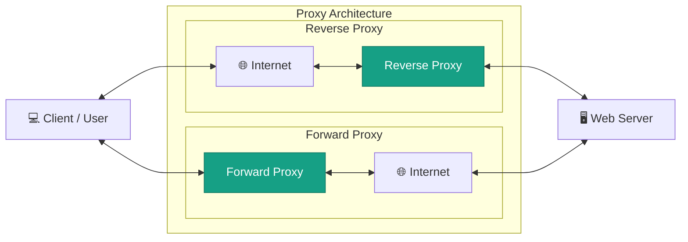

# 2026-11-14

## Today's Focus: Forward Proxy and Reverse Proxy

##  Architecture



## Forward Proxy

### How It Works

In the Forward Proxy part of the architecture diagram, the Client 
represents a company employee, the Forward Proxy represents the company's 
corporate proxy, and the Server represents an external website such as Google.

Suppose the company requires all outbound internet requests to pass through 
its corporate proxy.

The request follows these steps:

1. The company employee opens a browser and accesses Google.
2. The browser sends the request to the corporate forward proxy.
3. The forward proxy checks the company's access-control policies.
4. If the request is permitted, the proxy connects to Google 
through the internet on behalf of the employee.
5. Google processes the request and returns the response through the
internet and forward proxy.
6. The employee receives the response.

**The forward proxy represents the client.**

Server receives the external connection from the corporate proxy 
rather than directly from the employee's network.

### Common use cases 

- Controlling outbound internet access.
- Enforcing corporate network security policies.
- Logging outbound requests.
- Allowing CI/CD runners to download external dependencies.
- Restricting access to approved destinations.

### Troubleshooting Scenarios

### Scenario 1: Proxy Connection Refused

**Problem**

A company employee or internal application cannot connect to the corporate forward proxy.

Example error:

```text
curl: (7) Failed to connect to 10.10.10.10 port 3128:
Connection refused
```

**Investigation**

**Step 1: Check the Squid service status.**

```bash
sudo systemctl status squid --no-pager
```

Possible output:

```text
● squid.service - Squid caching proxy
     Loaded: loaded (/usr/lib/systemd/system/squid.service)
     Active: failed (Result: exit-code)
```

The service is not running.

**Step 2: Check whether Squid is listening on port 3128.**

```bash
sudo ss -lntp | grep ':3128'
```

Expected when healthy:

```text
LISTEN 0 4096 0.0.0.0:3128 0.0.0.0:* users:(("squid",pid=1234,fd=10))
```

If no output is returned, Squid is not listening on the expected port.

**Step 3: Review Squid service logs.**

```bash
sudo journalctl -u squid -n 50 --no-pager
```

Look for configuration errors, permission errors or startup failures.

**Step 4: Check firewall rules.**

```bash
sudo firewall-cmd --list-all
```

Expected when the proxy port is permitted:

```text
ports: 3128/tcp
```

If the port is missing, check whether the firewall policy is preventing client access.

**Possible Causes**

- Squid service is stopped.
- Squid is listening on the wrong port or interface.
- A firewall is rejecting the connection.
- The proxy server is unavailable.

**Resolution**

Restore the Squid service or correct the listening and network configuration.

Retest from the client:

```bash
curl -v -x http://10.10.10.10:3128 https://www.google.com
```

Expected:

```text
* Connected to 10.10.10.10 (10.10.10.10) port 3128
* Establish HTTP proxy tunnel to www.google.com:443
< HTTP/1.1 200 Connection established
```

The `200 Connection established` response confirms that the proxy has established the HTTPS tunnel. The subsequent TLS handshake and HTTP request must also complete successfully.


### Scenario 2: HTTP 403 Forbidden

**Problem**

The client can connect to the forward proxy, but the proxy denies access to the requested external website.

Example response:

```text
HTTP/1.1 403 Forbidden
```

**Investigation**

**Step 1: Check the Squid access log.**

```bash
sudo tail -n 20 /var/log/squid/access.log
```

Possible output:

```text
1731571200.123 0 192.168.10.25 TCP_DENIED/403 3872 CONNECT www.google.com:443 - HIER_NONE/- text/html
```

`TCP_DENIED/403` indicates that Squid denied the request.

**Step 2: Check the client IP address.**

On the client:

```bash
ip addr show
```

Example:

```text
inet 192.168.10.25/24 brd 192.168.10.255 scope global eth0
```

Compare the client address with the authorised subnet configured in Squid.

**Step 3: Review Squid access-control rules.**

```bash
sudo grep -nE '^(acl|http_access)' /etc/squid/squid.conf
```

Example:

```text
acl lab_clients src 192.168.10.0/24
acl SSL_ports port 443
acl CONNECT method CONNECT
http_access deny !SSL_ports
http_access allow lab_clients
http_access deny all
```

The client must match the permitted ACL rules.

**Possible Causes**

- The client IP is not authorised.
- The destination port is blocked by ACL rules.
- Access-control rules are incorrectly ordered.
- The requested website is restricted by corporate policy.

**Resolution**

Correct the ACL configuration or obtain the required access permission.

After the change, retest:

```bash
curl -v -x http://10.10.10.10:3128 https://www.google.com
```

Expected:

```text
< HTTP/1.1 200 Connection established
```

The Squid access log should now show a successful tunnel:

```text
TCP_TUNNEL/200 CONNECT www.google.com:443
```


## Reverse Proxy

### How It Works

In the Reverse Proxy part of the architecture diagram, the Client 
represents an external user, the Reverse Proxy represents Nginx or F5,
and the Server represents the bank's backend Java Web Application.

Suppose a bank provides a public application URL:

`https://bank.example.com`

External users access this URL without knowing the internal addresses 
of the backend application servers.

The request follows these steps:

1. An external user accesses `https://bank.example.com`.
2. The request travels through the internet and reaches the reverse proxy, such as Nginx or F5.
3. The reverse proxy receives the request and forwards it to the backend Java Web Application.
4. The Java application processes the request.
5. The response returns through the reverse proxy and internet to the external user.

**The reverse proxy represents the backend server.**

External users access a common entry point without needing to know
the backend server's internal address.

### Common use cases 

- Providing a single entry point for applications.
- Routing requests to backend services.
- TLS termination.
- Forwarding client information through HTTP headers.
- Load balancing across multiple backend servers.
- Centralised access logging.
