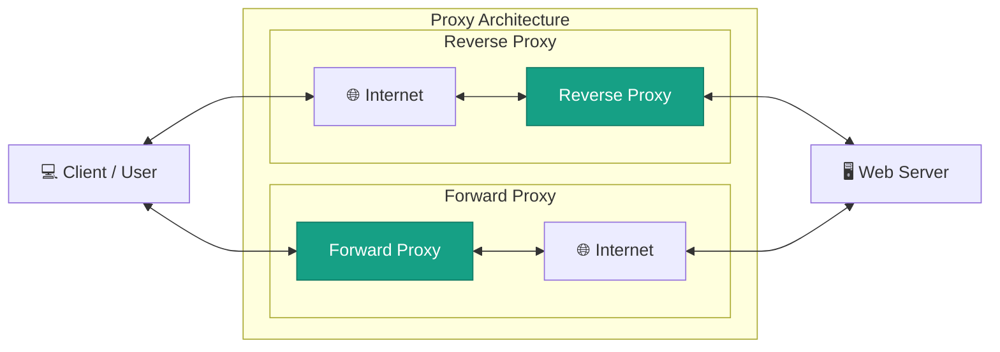

# 2026-11-15

## Today's Focus: Forward Proxy and Reverse Proxy

##  Architecture



## Forward Proxy

### How It Works

In the Forward Proxy part of the architecture diagram, the Client
represents a company employee, the Forward Proxy represents the company's
corporate proxy, and the Server represents an external website such as Google.

Suppose the company requires all outbound internet requests to pass through
its corporate proxy.

The request follows these steps:

1. The company employee opens a browser and accesses Google.
2. The browser sends the request to the corporate forward proxy.
3. The forward proxy checks the company's access-control policies.
4. If the request is permitted, the proxy connects to Google
   through the internet on behalf of the employee.
5. Google processes the request and returns the response through the
   internet and forward proxy.
6. The employee receives the response.

**The forward proxy represents the client.**

The server receives the external connection from the corporate proxy
rather than directly from the employee's network.

### Common use cases

- Controlling outbound internet access.
- Enforcing corporate network security policies.
- Logging outbound requests.
- Allowing CI/CD runners to download external dependencies.
- Restricting access to approved destinations.

### Troubleshooting Scenarios

### Scenario 1: Proxy Connection Refused

**Problem**

A company employee or internal application cannot connect to the corporate forward proxy.

Example error:

```text
curl: (7) Failed to connect to 10.10.10.10 port 3128:
Connection refused
```

**Investigation**

**Step 1: Check the Squid service status.**

```bash
sudo systemctl status squid --no-pager
```

Possible output:

```text
● squid.service - Squid caching proxy
     Loaded: loaded (/usr/lib/systemd/system/squid.service)
     Active: failed (Result: exit-code)
```

The service is not running.

**Step 2: Check whether Squid is listening on port 3128.**

```bash
sudo ss -lntp | grep ':3128'
```

Expected when healthy:

```text
LISTEN 0 4096 0.0.0.0:3128 0.0.0.0:* users:(("squid",pid=1234,fd=10))
```

If no output is returned, Squid is not listening on the expected port.

**Step 3: Review Squid service logs.**

```bash
sudo journalctl -u squid -n 50 --no-pager
```

Look for configuration errors, permission errors or startup failures.

**Step 4: Check firewall rules.**

```bash
sudo firewall-cmd --list-all
```

Expected when the proxy port is permitted:

```text
ports: 3128/tcp
```

If the port is missing, check whether the firewall policy is preventing client access.

**Possible Causes**

- Squid service is stopped.
- Squid is listening on the wrong port or interface.
- A firewall is rejecting the connection.
- The proxy server is unavailable.

**Resolution**

Restore the Squid service or correct the listening and network configuration.

Retest from the client:

```bash
curl -v -x http://10.10.10.10:3128 https://www.google.com
```

Expected:

```text
* Connected to 10.10.10.10 (10.10.10.10) port 3128
* Establish HTTP proxy tunnel to www.google.com:443
< HTTP/1.1 200 Connection established
```

The `200 Connection established` response confirms that the proxy has established the HTTPS tunnel. The subsequent TLS handshake and HTTP request must also complete successfully.


### Scenario 2: HTTP 403 Forbidden

**Problem**

The client can connect to the forward proxy, but the proxy denies access to the requested external website.

Example response:

```text
HTTP/1.1 403 Forbidden
```

**Investigation**

**Step 1: Check the Squid access log.**

```bash
sudo tail -n 20 /var/log/squid/access.log
```

Possible output:

```text
1731571200.123 0 192.168.10.25 TCP_DENIED/403 3872 CONNECT www.google.com:443 - HIER_NONE/- text/html
```

`TCP_DENIED/403` indicates that Squid denied the request.

**Step 2: Check the client IP address.**

On the client:

```bash
ip addr show
```

Example:

```text
inet 192.168.10.25/24 brd 192.168.10.255 scope global eth0
```

Compare the client address with the authorized subnet configured in Squid.

**Step 3: Review Squid access-control rules.**

```bash
sudo grep -nE '^(acl|http_access)' /etc/squid/squid.conf
```

Example:

```text
acl lab_clients src 192.168.10.0/24
acl SSL_ports port 443
acl CONNECT method CONNECT
http_access deny !SSL_ports
http_access allow lab_clients
http_access deny all
```

The client must match the permitted ACL rules.

**Possible Causes**

- The client IP is not authorized.
- The destination port is blocked by ACL rules.
- Access-control rules are incorrectly ordered.
- The requested website is restricted by corporate policy.

**Resolution**

Correct the ACL configuration or obtain the required access permission.

After the change, retest:

```bash
curl -v -x http://10.10.10.10:3128 https://www.google.com
```

Expected:

```text
< HTTP/1.1 200 Connection established
```

The Squid access log should now show a successful tunnel:

```text
TCP_TUNNEL/200 CONNECT www.google.com:443
```


## Reverse Proxy

### How It Works

In the Reverse Proxy part of the architecture diagram, the Client
represents an external user, the Reverse Proxy represents Nginx or F5,
and the Server represents the bank's backend Java Web Application.

Suppose a bank provides a public application URL:

`https://bank.example.com`

External users access this URL without knowing the internal addresses
of the backend application servers.

The request follows these steps:

1. An external user accesses `https://bank.example.com`.
2. The request travels through the internet and reaches the reverse proxy, such as Nginx or F5.
3. The reverse proxy receives the request and forwards it to the backend Java Web Application.
4. The Java application processes the request.
5. The response returns through the reverse proxy and internet to the external user.

**The reverse proxy represents the backend server.**

External users access a common entry point without needing to know
the backend server's internal address.

### Common use cases

- Providing a single entry point for applications.
- Routing requests to backend services.
- TLS termination.
- Forwarding client information through HTTP headers.
- Load balancing across multiple backend servers.
- Centralised access logging.

### Troubleshooting Scenarios

### Scenario 1: HTTP 502 Bad Gateway

**Problem**

An external user receives HTTP 502 when accessing the bank application through Nginx or F5.

Example response:

```text
HTTP/1.1 502 Bad Gateway
```

Possible Nginx error log:

```text
connect() failed (111: Connection refused)
while connecting to upstream
```

**Investigation**

**Step 1: Check the Nginx service status.**

```bash
sudo systemctl status nginx --no-pager
```

Expected:

```text
Active: active (running)
```

If Nginx is stopped, the external client may be unable to reach the application entry point.

**Step 2: Check the Nginx listening port.**

```bash
sudo ss -lntp | grep -E ':80|:443'
```

Expected:

```text
LISTEN 0 511 0.0.0.0:80 0.0.0.0:* users:(("nginx",pid=1200,fd=6))
LISTEN 0 511 0.0.0.0:443 0.0.0.0:* users:(("nginx",pid=1200,fd=7))
```

The actual ports depend on the Nginx configuration.

**Step 3: Check the backend Java applications.**

```bash
sudo ss -lntp | grep -E ':8081|:8082'
```

Expected:

```text
LISTEN 0 128 10.20.0.11:8081 0.0.0.0:* users:(("java",pid=2451,fd=55))
LISTEN 0 128 10.20.0.12:8082 0.0.0.0:* users:(("java",pid=2510,fd=56))
```

If one backend port is missing, investigate that application instance.

**Step 4: Test backend connectivity independently.**

```bash
curl -v --connect-timeout 5 http://10.20.0.11:8081/actuator/health
```

Expected when healthy:

```text
HTTP/1.1 200
Content-Type: application/vnd.spring-boot.actuator.v3+json

{"status":"UP"}
```

A connection-refused error indicates that the backend is not accepting connections at the specified address and port.

**Step 5: Review Nginx error logs.**

```bash
sudo tail -n 50 /var/log/nginx/error.log
```

Look for:

```text
connect() failed (111: Connection refused)
while connecting to upstream
```

**Possible Causes**

- A Java application is stopped.
- The backend port is incorrect.
- The application is not listening on the expected interface.
- The upstream connection is being rejected.
- Network or access-control restrictions prevent the connection.

**Resolution**

Restore backend connectivity or correct the upstream configuration.

If only Java App 1 is affected but Java App 2 is healthy, verify whether the load balancer can route requests to the healthy instance.

Retest through the reverse proxy:

```bash
curl -v -H 'Host: bank.example.com' http://127.0.0.1/
```

Expected:

```text
HTTP/1.1 200 OK
```

The actual response depends on the application's endpoint.

### Scenario 2: HTTP 503 Service Unavailable

**Problem**

Users receive HTTP 503 when accessing a Java application through 
Nginx reverse proxy.

Example response:

```text
HTTP/1.1 503 Service Temporarily Unavailable
```

**Investigation**

**Step 1: Check Nginx error log**

```bash
sudo tail -n 50 /var/log/nginx/error.log
```

Example output:

```text
no live upstreams while connecting to upstream
```

This indicates that Nginx has no available upstream server to handle the request.

**Step 2: Check backend availability**

```bash
curl -v http://10.20.0.11:8081/actuator/health
curl -v http://10.20.0.12:8081/actuator/health
```

Example output:

```text
curl: (7) Failed to connect to 10.20.0.11 port 8081
curl: (7) Failed to connect to 10.20.0.12 port 8081
```

Both backend instances are unreachable.

**Step 3: Check backend service status**

```bash
systemctl status demo-app --no-pager
```

Example output:

```text
Active: failed (Result: exit-code)
```

Check application logs:

```bash
journalctl -u demo-app -n 100 --no-pager
```

**Common causes**

- All backend instances are stopped or unhealthy.
- Application startup failed.
- Backend ports are not listening.
- Firewall or network rules prevent Nginx from reaching the backend.
- Backend instances are temporarily overloaded.

**Resolution**

Restore at least one healthy backend instance and verify connectivity 
from the Nginx server:

```bash
curl -v http://10.20.0.11:8081/actuator/health
```

Expected response:

```text
{"status":"UP"}
```

Retest through Nginx:

```bash
curl -i -H 'Host: bank.example.com' http://127.0.0.1/
```

Expected response:

```text
HTTP/1.1 200 OK
```


### Scenario 3: HTTP 504 Gateway Timeout

**Problem**

The reverse proxy cannot obtain a timely response from the backend application.

Example response:

```text
HTTP/1.1 504 Gateway Time-out
```

Possible Nginx error log:

```text
upstream timed out (110: Connection timed out)
while reading response header from upstream
```

**Investigation**

**Step 1: Check the Nginx error log.**

```bash
sudo tail -n 100 /var/log/nginx/error.log
```

Look for:

```text
upstream timed out
```

This indicates that Nginx did not receive the expected upstream response within the configured timeout.

**Step 2: Check backend response time.**

```bash
curl -sS -o /dev/null \
  -w 'HTTP Status: %{http_code}\nTotal Time: %{time_total}s\n' \
  --max-time 35 \
  http://10.20.0.11:8081/actuator/health
```

Possible output:

```text
HTTP Status: 200
Total Time: 12.456s
```

A successful HTTP response does not necessarily mean the 
backend is performing normally. A response taking 12 seconds may 
exceed the proxy's configured timeout.

**Step 3: Check Java application resource usage.**

```bash
ps -eo pid,comm,%cpu,%mem --sort=-%cpu | head -10
```

Example:

```text
PID   COMMAND  %CPU  %MEM
2451  java     95.0  35.0
2510  java     12.0  18.0
```

A process with high CPU usage may indicate application resource contention.

**Step 4: Check database connectivity and application logs.**

```bash
sudo journalctl -u demo-app -n 100 --no-pager
```

Look for:

- Slow database queries.
- Connection pool exhaustion.
- External API timeouts.
- Thread pool exhaustion.
- Application processing delays.

**Possible Causes**

- The backend application responds too slowly.
- Database queries or external API calls are delayed.
- The upstream timeout is exceeded.
- Network connectivity is interrupted.
- Application threads or connection pools are exhausted.

**Resolution**

Investigate backend latency and network conditions before increasing timeout values.

After resolving the issue, repeat the response-time test and verify that the application 
responds within the expected service time:

```bash
curl -sS -o /dev/null \
  -w 'HTTP Status: %{http_code}\nTotal Time: %{time_total}s\n' \
  --max-time 35 \
  http://10.20.0.11:8081/actuator/health
```

Possible output:

```text
HTTP Status: 200
Total Time: 0.245s
```

### Summary of Failure Scenarios

| Scenario  | Failure Symptoms    | Key Investigation Area                                        |
|-----------|---------------------|---------------------------------------------------------------|
| HTTP 502  | Bad Gateway         | Backend connection failed, invalid response                   |
| HTTP 503  | Service Unavailable | No healthy backend instances are available to handle requests |
| HTTP 504  | Gateway Timeout     | Backend response too slow, request timed out                  |
