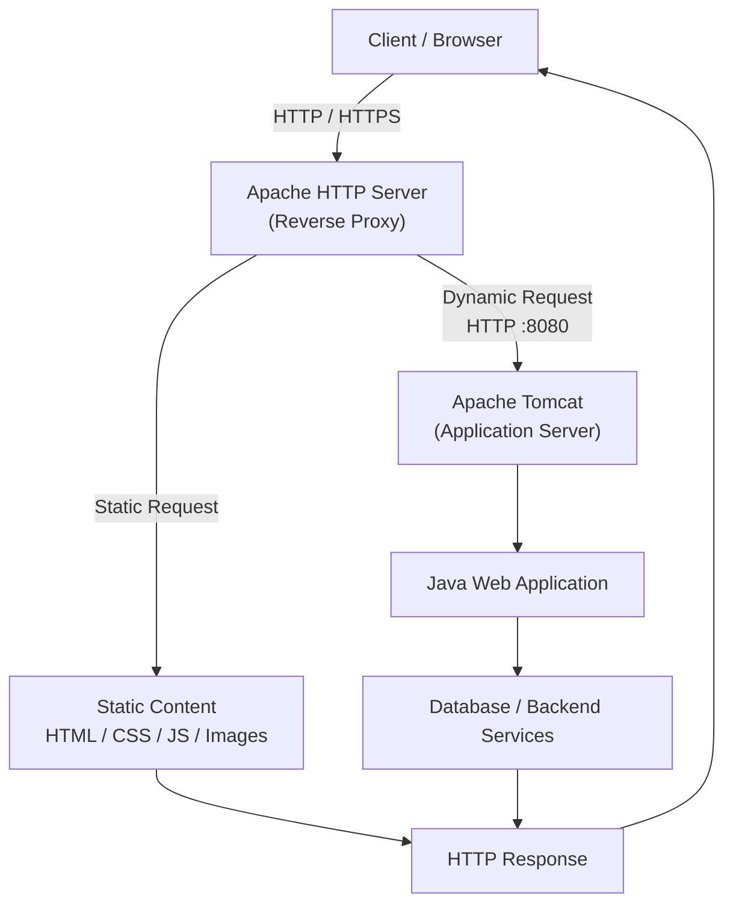

# 2026-11-20

# Today's Focus: Web Server - Tomcat and Apache HTTP Server

## Architecture



## Apache HTTP Server

### How It Works

Apache HTTP Server is an open-source Web Server that handles 
incoming HTTP/HTTPS requests.

It can serve static content directly and forward dynamic application
requests to backend application servers such as Tomcat.

### Common Use Cases

- Serving static files such as HTML, CSS, JavaScript and images.
- Acting as a reverse proxy for backend applications.
- Handling HTTPS connections and SSL/TLS termination.
- Forwarding requests to Tomcat through `mod_proxy`.
- Distributing traffic across multiple backend servers.
- Applying access control and URL-based routing.

## Apache Tomcat

### How It Works

Apache Tomcat is a Java application server and Servlet container.
It runs Java web applications and processes dynamic requests, 
including Java Servlets and JSP applications.

Unlike Apache HTTP Server, Tomcat's primary responsibility is 
executing Java web applications rather than general-purpose web traffic management.

### Common Use Cases

- Running Java web applications.
- Processing Servlet and JSP requests.
- Hosting Java-based application services.
- Managing application deployment through WAR files.
- Handling application sessions and request processing.
- Providing HTTP connectivity through Tomcat Connectors.

### Troubleshooting Scenarios

### Scenario 1: Apache Cannot Connect to Tomcat

**Problem**

Users cannot access a Java application through Apache.

Apache returns an HTTP 502 or 503 response.

Example:

```text
HTTP/1.1 503 Service Unavailable
```

The Apache service is running, but the backend Tomcat application is unavailable.

**Investigation**

**Step 1: Check Apache service status.**

```bash
sudo systemctl status httpd
```

Expected:

```text
Active: active (running)
```

Apache is running normally.

**Step 2: Check Tomcat service status.**

```bash
sudo systemctl status "$TOMCAT_SERVICE"
```

Possible output:

```text
Active: failed (Result: exit-code)
```

Tomcat is not running successfully.

**Step 3: Check whether Tomcat is listening on port 8080.**

```bash
sudo ss -lntp | grep ':8080'
```

Possible output:

```text
(No output)
```

No process is listening on port 8080.

**Step 4: Test Tomcat directly.**

```bash
curl -v --connect-timeout 5 \
  http://127.0.0.1:8080/app/
```

Possible output:

```text
curl: (7) Failed to connect to 127.0.0.1 port 8080
```

This confirms that the backend connection cannot be established.

**Step 5: Review Apache error logs.**

```bash
sudo tail -n 100 /var/log/httpd/error_log
```

Possible output:

```text
AH00957: HTTP: attempt to connect to 127.0.0.1:8080 failed

AH01114: HTTP: failed to make connection to backend
```

Apache cannot establish a connection to the Tomcat backend.

**Step 6: Review Tomcat logs.**

```bash
sudo journalctl -u "$TOMCAT_SERVICE" \
  -n 100 --no-pager
```

If Tomcat uses file-based logging:

```bash
tail -n 100 "$CATALINA_BASE"/logs/catalina.out
```

Check for:

- Application startup failures.
- Port binding errors.
- JVM errors.
- OutOfMemoryError.
- Configuration problems.

**Step 7: Check firewall and SELinux restrictions.**

```bash
getenforce

getsebool httpd_can_network_connect
```

If SELinux is enabled, review recent access denials:

```bash
sudo ausearch -m AVC -ts recent
```

These checks help identify whether Apache is prevented from connecting to the backend.

**Possible Causes**

- Tomcat service is stopped or has crashed.
- Tomcat is listening on a different port.
- Apache points to an incorrect backend address.
- Tomcat application failed during startup.
- Firewall rules block the connection.
- SELinux prevents Apache from connecting to the backend.

**Resolution**

1. Fix the underlying Tomcat startup or configuration issue.
2. Ensure Tomcat is listening on the expected port.
3. Verify Apache's backend address and port.
4. Correct firewall or SELinux restrictions if confirmed.
5. Restart or reload the affected service when appropriate.

If SELinux is confirmed to block Apache's outbound connection, review whether the following setting is appropriate:

```bash
sudo setsebool -P httpd_can_network_connect on
```

Retest Tomcat directly:

```bash
curl -I http://127.0.0.1:8080/app/
```

Expected:

```text
HTTP/1.1 200 OK
```

Retest through Apache:

```bash
curl -I http://127.0.0.1/app/
```

Expected:

```text
HTTP/1.1 200 OK
```

The application should now be accessible through Apache.


