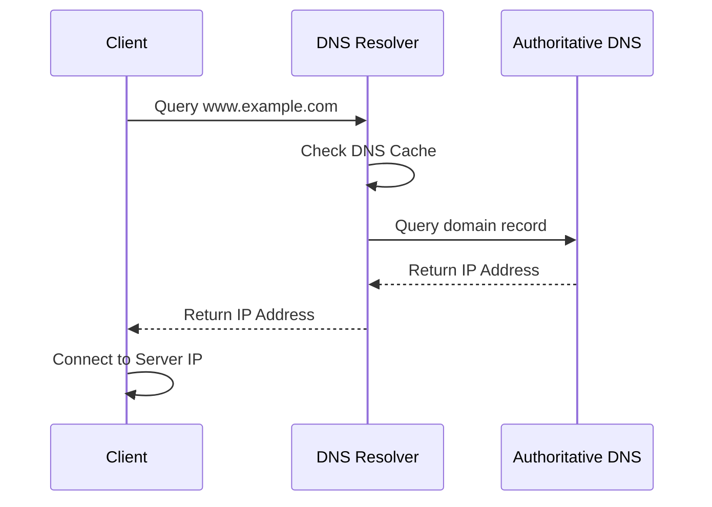
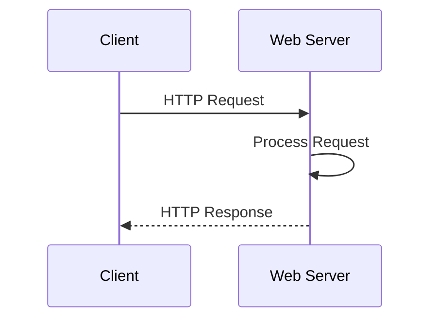
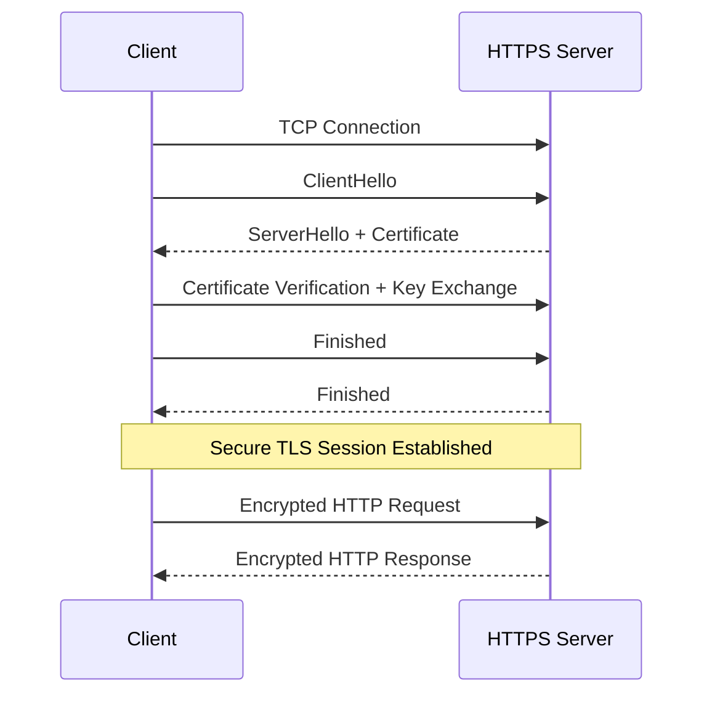

# 2026-11-21

# Today's Focus: Networking and Protocols - DNS, HTTP, HTTPS, SSL/TLS and SSH

## DNS (Domain Name System)

### DNS Resolution Flow



## HTTP (Hypertext Transfer Protocol)

### HTTP Communication Flow



## HTTPS (HTTP Secure)

### HTTPS Communication Flow



## SSL/TLS (Secure Sockets Layer / Transport Layer Security)

### TLS Handshake

The TLS handshake establishes a secure communication session between a client and server.

Main steps:

1. ClientHello: Client proposes supported TLS versions, cipher suites and other parameters.
2. ServerHello: Server selects the TLS parameters.
3. Certificate: Server provides its certificate for authentication.
4. Key Exchange: Client and server establish shared session keys.
5. Finished: Both sides verify the handshake.
6. Secure Communication: Application data is encrypted using the negotiated keys.

## SSH (Secure Shell)

### SSH Connection Architecture


## Troubleshooting Scenarios

### Scenario 1: DNS Resolution Failure

**Problem:**

An application cannot connect to an external service using its domain name.

The application reports:

```text
java.net.UnknownHostException: api.example.com
```

**Investigation**

**Step 1: Check DNS resolution**

```bash
nslookup api.example.com
```

Expected result:

```text
Server:  192.0.2.53
Address: 192.0.2.53#53

Name:    api.example.com
Address: 203.0.113.10
```

If the query fails, investigate DNS configuration and DNS server availability.

**Step 2: Check DNS resolver configuration**

```bash
cat /etc/resolv.conf
```

Expected result:

```text
nameserver 192.0.2.53
```

Verify that the configured DNS server is correct and reachable.

**Step 3: Query a specific DNS server**

```bash
dig @192.0.2.53 api.example.com A
```

Expected result:

```text
status: NOERROR
ANSWER SECTION:
api.example.com. 300 IN A 203.0.113.10
```

If the configured DNS server fails but another authorized DNS server 
resolves the domain, investigate the configured resolver or its upstream DNS path.

**Step 4: Verify network connectivity to DNS server**

```bash
nc -zvu 192.0.2.53 53
```

**Possible Causes:**

- DNS server is unavailable.
- Incorrect DNS configuration.
- DNS record does not exist.
- Domain name is incorrect.
- DNS cache contains outdated records.

**Resolution:**

Correct the DNS server configuration, DNS records, 
or network rules according to the root cause.

---

## Scenario 2: HTTPS Connection Fails Due to TLS Certificate Verification

**Problem:**

An application cannot establish an HTTPS connection to an external API.

Error message:

```text
javax.net.ssl.SSLHandshakeException:
PKIX path building failed
```

**Investigation**

**Step 1: Inspect the server certificate chain**

```bash
openssl s_client -connect api.example.com:443 \
  -servername api.example.com -showcerts
```

Expected result:

```text
Certificate chain
 0 s:CN=api.example.com
   i:CN=Example Intermediate CA
 1 s:CN=Example Intermediate CA
   i:CN=Example Root CA
```

Check whether the server provides the expected certificate chain.

**Step 2: Check certificate validity**

```bash
echo | openssl s_client \
  -connect api.example.com:443 \
  -servername api.example.com 2>/dev/null \
  | openssl x509 -noout -dates
```

Verify that the certificate has not expired.

**Step 3: Check certificate verification result**

```bash
echo | openssl s_client \
  -connect api.example.com:443 \
  -servername api.example.com
```

Expected successful result:

```text
Verify return code: 0 (ok)
```

If verification fails, inspect the certificate chain and trusted CA configuration.

**Step 4: Check Java truststore configuration**

```bash
keytool -list -keystore "$JAVA_HOME/lib/security/cacerts"
```

For applications using a custom truststore, inspect the configured truststore path and its certificates instead.

**Possible Causes:**

- Server certificate has expired.
- Certificate is issued by an untrusted CA.
- Intermediate certificate is missing.
- Client truststore does not contain the required CA certificate.
- Incorrect certificate chain configuration.

**Resolution:**

- Renew expired certificates.
- Configure the correct certificate chain on the server.
- Import the trusted CA certificate into the appropriate client truststore when required.
- Verify that the application is using the expected truststore.

Do not disable certificate verification as a permanent workaround.

---

## Scenario 3: SSH Connection Refused

**Problem:**

An administrator cannot connect to a Linux server using SSH.

Error message:

```text
ssh: connect to host 192.0.2.10 port 22:
Connection refused
```

**Investigation**

**Step 1: Check SSH service status**

```bash
systemctl status sshd
```

Expected result:

```text
Active: active (running)
```

If the service is stopped:

```bash
systemctl start sshd
```

**Step 2: Check SSH listening port**

```bash
ss -tlnp | grep sshd
```

Expected result:

```text
LISTEN 0 128 0.0.0.0:22 0.0.0.0:* users:(("sshd",pid=1234,fd=3))
```

Verify that SSH is listening on the expected port and interface.

**Step 3: Check firewall rules**

```bash
firewall-cmd --list-all
```

If SSH is not allowed and firewalld is the active firewall:

```bash
firewall-cmd --add-service=ssh --permanent
firewall-cmd --reload
```

Only modify firewall rules after confirming the intended access policy.

**Step 4: Check SSH server logs**

```bash
journalctl -u sshd -n 50 --no-pager
```

Review SSH daemon errors and startup failures.

**Possible Causes:**

- SSH daemon is not running.
- SSH service is listening on a different port.
- Firewall blocks the connection.
- SSH server is not listening on the expected network interface.

**Resolution:**

Start the SSH service, correct its listening configuration, 
or update the firewall rules according to the intended security policy.
