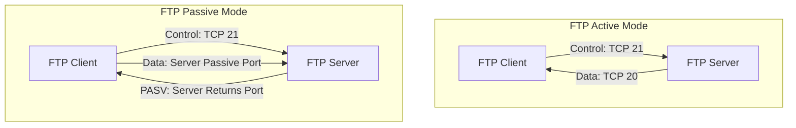
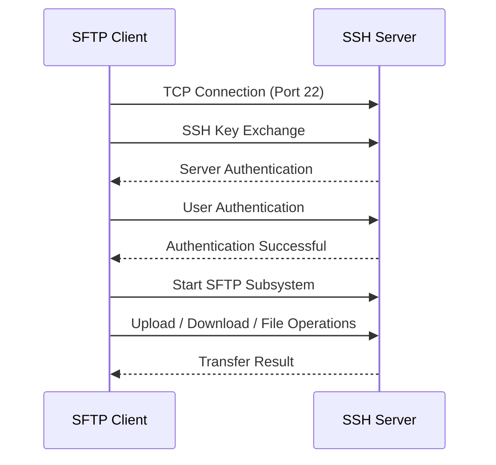
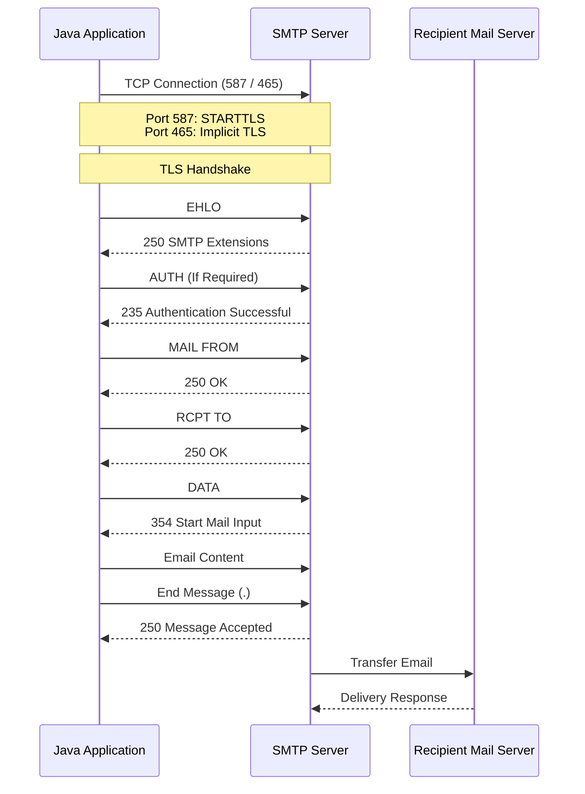
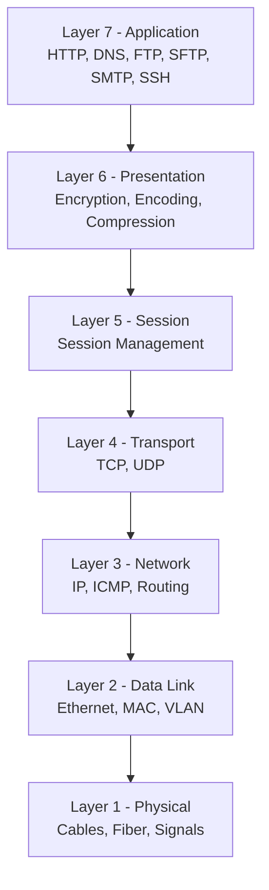

# 2026-11-22

# Today's Focus: Networking and Protocols - FTP, SFTP, SMTP and OSI Model

## FTP (File Transfer Protocol)

FTP is a standard network protocol used to transfer files between a client and a server.

Note:
- FTP does not encrypt usernames, passwords, or transferred data by default.
- FTP should not be used to transfer sensitive information over untrusted 
networks without additional protection.

### FTP Connection Architecture

- **Active Mode**: The server initiates the data connection to the client.

- **Passive Mode**: The client initiates both control and data connections.



---

## SFTP (SSH File Transfer Protocol)

SFTP is a secure file transfer protocol that operates over SSH.
Unlike FTP, SFTP uses a single SSH connection for both commands and file transfer.

### SFTP Connection Architecture



---

## SMTP (Simple Mail Transfer Protocol)

### SMTP Communication Flow



---

## OSI Model (Open Systems Interconnection Model)

### OSI Seven Layers



## Troubleshooting Scenarios

## Scenario 1: SFTP File Transfer Fails Due to Permission Denied

**Problem:**

An application can establish an SFTP connection to a remote server, but uploading a file fails.

Error message:

```text
Permission denied
Couldn't upload file: Permission denied
```

**Investigation**

**Step 1: Verify SFTP connectivity**

```bash
sftp user@192.0.2.10
```

Expected result:

```text
Connected to 192.0.2.10.
sftp>
```

If authentication fails, investigate SSH credentials or public key configuration.

**Step 2: Check remote directory permissions**

```bash
sftp> pwd
sftp> ls -ld /opt/app
```

Expected result:

```text
drwxr-xr-x 2 appuser appgroup 4096 /opt/app
```

Verify that the SFTP user has the required write permissions.

**Step 3: Check remote user identity**

Connect to the server through SSH:

```bash
ssh user@192.0.2.10
```

Then:

```bash
id
```

Expected result:

```text
uid=1001(user) gid=1001(user) groups=1001(user)
```

**Step 4: Check directory ownership and permissions**

```bash
ls -ld /opt/app
namei -l /opt/app
```

Check directory ownership, group membership, and execute permissions on parent directories.

**Possible Causes:**

- SFTP user does not have write permission.
- Incorrect directory ownership.
- Parent directory permissions prevent access.
- SELinux policy blocks file operations.
- SSH server uses a restricted SFTP configuration.

**Resolution:**

Grant the appropriate directory permissions or update 
ownership according to the intended access policy.

Verify:

```bash
sftp user@192.0.2.10
put test.txt
ls -l test.txt
```

Expected result:

File upload succeeds and the uploaded file is visible in the remote directory.

---

### Scenario 2: FTP Passive Mode Data Connection Timeout

**Problem:**

An FTP client can connect to the FTP server and authenticate successfully, but listing directories or transferring files fails.

Error message:

```text
227 Entering Passive Mode (192,0,2,10,195,80)
425 Can't open data connection
```

**Investigation**

**Step 1: Verify FTP control connection**

```bash
nc -zv 192.0.2.10 21
```

Expected result:

```text
Connection to 192.0.2.10 21 port [tcp/*] succeeded!
```

**Step 2: Check FTP passive mode response**

Use an FTP client with verbose output:

```bash
ftp -d 192.0.2.10
```

Or use:

```bash
lftp -d ftp://192.0.2.10
```

Look for the PASV response and the data port returned by the server.

For example:

```text
227 Entering Passive Mode (192,0,2,10,195,80)
```

The passive data port is:

```text
195 * 256 + 80 = 50000
```

**Step 3: Test passive data port connectivity**

```bash
nc -zv 192.0.2.10 50000
```

Expected result:

```text
Connection to 192.0.2.10 50000 port [tcp/*] succeeded!
```

Note: The passive port is negotiated dynamically and may change for each connection. Test while the FTP server is listening on the negotiated port.

**Step 4: Check firewall rules**

```bash
firewall-cmd --list-all
```

Verify that:
- TCP 21 is allowed.
- The configured passive port range is allowed.
- Network firewalls and security groups permit the data connection.

**Possible Causes:**

- Passive port range is not allowed by the firewall.
- FTP server advertises an incorrect external IP address.
- NAT configuration is incorrect.
- Network security rules block the data connection.

**Resolution:**

Configure a fixed passive port range on the FTP server 
and allow that range through the relevant firewalls and security groups.

Verify:

```bash
nc -zv 192.0.2.10 50000
lftp -d ftp://192.0.2.10
set ftp:passive-mode true
ls
```

Expected result:

Passive data connection succeeds and directory listing is returned without timeout.

---

### Scenario 3: SMTP Email Delivery Fails

**Problem:**

A Java application attempts to send notification emails through an SMTP server, but email delivery fails.

Error message:

```text
javax.mail.MessagingException:
Could not connect to SMTP host
```

**Investigation**

**Step 1: Check SMTP server connectivity**

```bash
nc -zv smtp.example.com 587
```

Expected result:

```text
Connection to smtp.example.com 587 port [tcp/*] succeeded!
```

If the connection times out, investigate firewall rules, routing, and SMTP server availability.

**Step 2: Check SMTP server response**

```bash
nc smtp.example.com 587
```

Expected result:

```text
220 smtp.example.com ESMTP Service Ready
```

Verify that the SMTP server responds with the expected greeting.

**Step 3: Verify STARTTLS support**

```bash
openssl s_client -starttls smtp \
  -connect smtp.example.com:587 \
  -servername smtp.example.com
```

Expected result:

```text
CONNECTED
...
Protocol  : TLSv1.3
...
Verify return code: 0 (ok)
```

If the TLS handshake fails, investigate TLS versions, certificates, and server configuration.

**Step 4: Check application SMTP configuration**

For a Java application, inspect:

```properties
spring.mail.host=smtp.example.com
spring.mail.port=587
spring.mail.properties.mail.smtp.starttls.enable=true
spring.mail.properties.mail.smtp.starttls.required=true
```

If SMTP authentication is required, verify the username and password configuration as well.

**Step 5: Check SMTP response and application logs**

Look for SMTP response codes such as:

```text
535 Authentication credentials invalid
550 Relay not permitted
```

These indicate different problems:

- 535: Authentication failed.
- 550: Recipient rejected or relay not permitted, depending on the server response.

**Possible Causes:**

- SMTP server is unavailable.
- Outbound SMTP traffic is blocked.
- Incorrect SMTP host or port.
- STARTTLS configuration does not match the server.
- SMTP authentication failed.
- SMTP relay policy rejects the sender or recipient.

**Resolution:**

Correct SMTP connection settings, TLS configuration, 
authentication credentials, or relay permissions according to the actual SMTP error.

Verify:

```bash
openssl s_client -starttls smtp \
  -connect smtp.example.com:587 \
  -servername smtp.example.com
```

Expected result: 

TLS handshake succeeds and the SMTP server returns a successful response.

Send a test email through the application and confirm that 
it reaches the recipient's mailbox.


