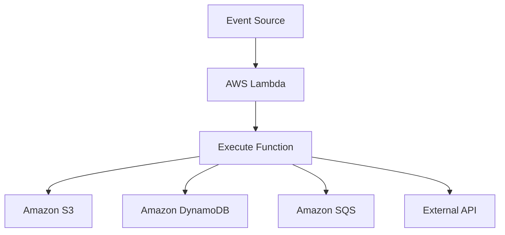

# 2026-11-23

# Today's Focus: Serverless - AWS Lambda

### Basic AWS Lambda Architecture



**Common Event Sources**

| Event Source     | Trigger                          |
|------------------|----------------------------------|
| API Gateway      | HTTP Request                     |
| S3               | Object Created / Deleted         |
| EventBridge      | Scheduled or Event-based Trigger |
| SQS              | New Messages                     |
| SNS              | Published Notifications          |
| DynamoDB Streams | Database Changes                 |

### Execution Role (IAM)

Lambda requires an IAM execution role to access other AWS resources.

Example permissions:

- `s3:GetObject`
- `s3:PutObject`
- `dynamodb:PutItem`
- `logs:CreateLogStream`
- `logs:PutLogEvents`

**Important:**

- Execution Role defines what the Lambda function can access.
- Resource-based Policy defines which principals or services can invoke the function.
- Follow the Principle of Least Privilege.

### Cold Start and Warm Start

**Cold Start**

AWS initializes a new execution environment before running the function.

Possible causes:
- New function execution environment.
- Scaling out due to increased traffic.
- Runtime initialization.
- Large deployment package or initialization workload.

**Warm Start**

An existing execution environment is reused for another invocation.

Possible optimizations:
- Reduce initialization workload.
- Reuse SDK clients outside the handler.
- Minimize deployment package size.
- Consider Provisioned Concurrency for latency-sensitive workloads.

## Troubleshooting Scenarios

### Scenario 1: Lambda Cannot Connect to RDS Due to VPC Networking Issue

**Problem:**

A Lambda function attempts to connect to an RDS database in a 
private subnet, but the database connection fails.

Error message:

```text
java.sql.SQLTransientConnectionException:
Connection timed out
```

**Investigation**

**Step 1: Check Lambda VPC configuration**

```bash
aws lambda get-function-configuration \
  --function-name order-processor \
  --query 'VpcConfig'
```

Expected result:

```json
{
  "SubnetIds": [
    "subnet-private-a",
    "subnet-private-b"
  ],
  "SecurityGroupIds": [
    "sg-lambda123"
  ]
}
```

Verify that Lambda is configured with the correct VPC, subnets and security groups.

**Step 2: Check RDS endpoint and port**

```bash
aws rds describe-db-instances \
  --db-instance-identifier order-db \
  --query 'DBInstances[0].{Endpoint:Endpoint.Address,Port:Endpoint.Port,Status:DBInstanceStatus}'
```

Expected result:

```json
{
  "Endpoint": "order-db.example.region.rds.amazonaws.com",
  "Port": 1521,
  "Status": "available"
}
```

Verify that the database endpoint and port match the application configuration.

**Step 3: Check RDS security group inbound rules**

```bash
aws ec2 describe-security-groups \
  --group-ids sg-rds123 \
  --query 'SecurityGroups[].IpPermissions'
```

Expected result:

```text
Protocol: TCP
Port: 1521
Source: sg-lambda123
```

Verify that the RDS security group allows inbound traffic from the Lambda security group.

**Step 4: Check subnet routing and network ACLs**

```bash
aws ec2 describe-route-tables \
  --filters Name=association.subnet-id,Values=subnet-private-a
```

Expected result:

```text
Destination: 10.42.0.0/16
Target: local
```

Verify that the VPC local route exists and that applicable network ACL rules allow the required traffic.

**Step 5: Check database connectivity from the Lambda environment**

Review application logs for database connection errors.

If necessary, deploy a temporary diagnostic Lambda function in the same VPC and security group configuration.

```bash
nc -zv order-db.example.region.rds.amazonaws.com 1521
```

Expected result:

```text
Connection to order-db.example.region.rds.amazonaws.com
1521 port [tcp/*] succeeded!
```

Note: The connectivity test must run inside the relevant VPC network environment, not from an unrelated local machine.

**Possible Causes:**

- Lambda is configured with the wrong VPC or subnet.
- Lambda security group does not allow outbound database traffic.
- RDS security group does not allow inbound traffic from Lambda.
- Network ACL blocks the connection.
- Incorrect RDS endpoint or port.
- Database is unavailable.

**Resolution:**

- Configure Lambda with the correct VPC and private subnets.
- Allow the required database port between Lambda and RDS security groups.
- Review subnet routing and network ACL rules.

Verify:

Execute the Lambda function again and check CloudWatch Logs.

Expected result:

```text
Database connection established successfully.
SQL query executed successfully.
```

The Lambda function can connect to RDS and retrieve the expected database records.

---

### Scenario 2: Lambda Invocation Throttled Due to Concurrency Limit

**Problem:**

A Lambda function receives a sudden increase in incoming requests, but some invocations are throttled because the available concurrency is insufficient.

Error message:

```text
TooManyRequestsException:
Rate Exceeded.
```

**Investigation**

**Step 1: Check function concurrency configuration**

```bash
aws lambda get-function-concurrency \
  --function-name order-processor
```

Expected result:

```json
{
  "ReservedConcurrentExecutions": 50
}
```

Verify whether Reserved Concurrency is limiting the maximum number of concurrent executions.

**Step 2: Check account concurrency configuration**

```bash
aws lambda get-account-settings \
  --query 'Account'
```

Expected result:

```json
{
  "ConcurrentExecutions": 1000,
  "UnreservedConcurrentExecutions": 950
}
```

Verify whether the account-level concurrency limit has been reached.

**Step 3: Check throttling metrics**

```bash
aws cloudwatch get-metric-statistics \
  --namespace AWS/Lambda \
  --metric-name Throttles \
  --dimensions Name=FunctionName,Value=order-processor \
  --start-time 2026-11-22T00:00:00Z \
  --end-time 2026-11-22T01:00:00Z \
  --period 300 \
  --statistics Sum
```

Expected result:

```text
Throttles: 120
```

An increasing Throttles metric indicates that Lambda invocations are being rejected due to concurrency limits.

**Step 4: Check concurrent executions**

```bash
aws cloudwatch get-metric-statistics \
  --namespace AWS/Lambda \
  --metric-name ConcurrentExecutions \
  --dimensions Name=FunctionName,Value=order-processor \
  --start-time 2026-11-22T00:00:00Z \
  --end-time 2026-11-22T01:00:00Z \
  --period 300 \
  --statistics Maximum
```

Expected result:

```text
Maximum: 50
```

If concurrent executions consistently reach the Reserved 
Concurrency limit, the function may need additional capacity.

**Possible Causes:**

- Reserved Concurrency is too low.
- Account concurrency limit has been reached.
- Incoming request volume increases suddenly.
- Function execution duration is too long.
- Downstream services cannot handle the request volume.

**Resolution:**

- Increase Reserved Concurrency where appropriate.
- Request a higher account concurrency quota if necessary.
- Optimize execution duration to reduce concurrency requirements.
- For traffic spikes, consider using SQS to buffer incoming requests
  and process messages at a controlled rate.

Verify:

Generate test traffic and monitor CloudWatch metrics.

Expected result:

- Throttles decrease.
- Concurrent executions remain within the expected capacity.
- Incoming requests are processed successfully.
- Downstream services remain healthy.

---

### Scenario 3: Lambda Asynchronous Invocation Fails Due to Event Processing Errors

**Problem:**

An S3 event triggers a Lambda function, but processing fails
because the application encounters an error.

Lambda retries the failed asynchronous invocation, and some events
are eventually discarded or delivered to a failure destination.

Error message:

```text
ERROR Processing S3 event failed.
java.lang.RuntimeException: Invalid object metadata
```

**Investigation**

**Step 1: Check asynchronous invocation configuration**

```bash
aws lambda get-function-event-invoke-config \
  --function-name order-processor
```

Expected result:

```json
{
  "MaximumRetryAttempts": 2,
  "MaximumEventAgeInSeconds": 3600,
  "DestinationConfig": {
    "OnFailure": {
      "Destination": "arn:aws:sqs:us-east-1:123456789012:lambda-failure-queue"
    }
  }
}
```

Verify the configured retry attempts, maximum event age and failure destination.

**Step 2: Check Lambda execution logs**

```bash
aws logs tail /aws/lambda/order-processor \
  --since 1h
```

Expected result:

```text
START RequestId: abc-123
Processing S3 event...
ERROR Invalid object metadata
END RequestId: abc-123
```

Identify the application exception causing the invocation to fail.

**Step 3: Check asynchronous invocation metrics**

Review the following CloudWatch metrics:

```text
Errors
Invocations
AsyncEventsDropped
DestinationDeliveryFailures
```

Verify whether failed events are being retried or dropped.

**Step 4: Check the failure destination**

If an SQS failure destination is configured:

```bash
aws sqs get-queue-attributes \
  --queue-url https://sqs.us-east-1.amazonaws.com/123456789012/lambda-failure-queue \
  --attribute-names ApproximateNumberOfMessages
```

Expected result:

```json
{
  "Attributes": {
    "ApproximateNumberOfMessages": "5"
  }
}
```

A non-zero message count indicates that failed invocation records may have been delivered to the failure queue.

**Possible Causes:**

- Application exceptions during event processing.
- Invalid or unexpected event payload.
- External service unavailable.
- Database or API connectivity issues.
- Retry attempts exhausted.
- Failure destination delivery problems.

**Resolution:**

- Fix the application-level exception or downstream dependency.
- Configure suitable retry attempts and maximum event age.
- Use an OnFailure destination or DLQ to capture failed events.
- Implement idempotency to prevent duplicate processing when events are retried.

Verify:

Upload a test object to the S3 bucket and check Lambda execution logs.

Expected result:

```text
START RequestId: xyz-456
Processing S3 event...
Object processed successfully.
END RequestId: xyz-456
REPORT RequestId: xyz-456
```

The event is processed successfully without repeated failures.

