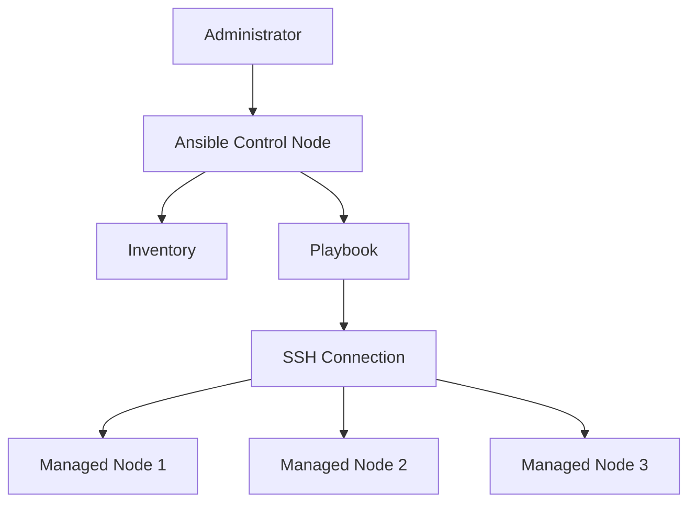

# 2026-11-24

# Today's Focus: Configuration Management - Ansible

### Basic Ansible Architecture



### Common Ansible Components

| Component    | Description                                     |
|--------------|-------------------------------------------------|
| Control Node | Server where Ansible is installed and executed. |
| Managed Node | Target server managed by Ansible.               |
| Inventory    | Defines target hosts and host groups.           |
| Playbook     | YAML file defining automation tasks.            |


## Troubleshooting Scenarios

### Scenario 1: Ansible Cannot Connect to Managed Nodes Due to SSH Authentication Failure

**Problem:**

An administrator executes an Ansible Playbook against multiple Linux servers, but some managed nodes cannot be reached.

Error message:

```text
web01 | UNREACHABLE!
Failed to connect to the host via ssh:
Permission denied (publickey).
```

**Investigation**

**Step 1: Check Inventory Configuration**

```bash
cat inventory.ini
```

Expected result:

```ini
[web_servers]
web01 ansible_host=10.0.1.11
web02 ansible_host=10.0.1.12

[web_servers:vars]
ansible_user=ec2-user
ansible_ssh_private_key_file=~/.ssh/id_rsa
```

Verify that the target IP addresses, SSH username and private key path are correct.

**Step 2: Check Private Key Permissions**

```bash
ls -l ~/.ssh/id_rsa
```

Expected result:

```text
-rw------- 1 user user ... id_rsa
```

If the private key permissions are too permissive:

```bash
chmod 600 ~/.ssh/id_rsa
```

**Step 3: Test SSH Connectivity Manually**

```bash
ssh -i ~/.ssh/id_rsa \
  ec2-user@10.0.1.11
```

Expected result:

```text
[ec2-user@web01 ~]$
```

Verify that SSH authentication succeeds outside Ansible.

**Step 4: Check Network Connectivity**

```bash
nc -zv 10.0.1.11 22
```

Expected result:

```text
Connection to 10.0.1.11 22 port [tcp/ssh] succeeded!
```

Verify that TCP port 22 is reachable.

**Step 5: Test Ansible Connectivity**

```bash
ansible web_servers -i inventory.ini \
  -m ansible.builtin.ping
```

Expected result:

```text
web01 | SUCCESS => {
    "changed": false,
    "ping": "pong"
}

web02 | SUCCESS => {
    "changed": false,
    "ping": "pong"
}
```

Note: Ansible Ping is an application-level connectivity test, not an ICMP ping. It also requires Python on the managed node for normal Linux module execution.

**Step 6: Enable Verbose Logging**

```bash
ansible web_servers -i inventory.ini \
  -m ansible.builtin.ping -vvv
```

Review SSH connection details and authentication errors.

**Possible Causes:**

- Incorrect SSH username or private key.
- Private key permissions are too permissive.
- SSH public key is missing from the managed node.
- Security Group or firewall blocks TCP port 22.
- Incorrect target IP address.
- SSH service is unavailable.
- Python is missing on the managed node.

**Resolution:**

- Correct the Inventory SSH configuration.
- Verify the private key and public key authentication.
- Set appropriate private key permissions.
- Allow TCP port 22 from the Control Node.
- Ensure Python is installed on managed nodes.
- Verify SSH connectivity before executing Playbooks.

**Verify:**

```bash
ansible web_servers -i inventory.ini \
  -m ansible.builtin.ping
```

Expected result:

```text
web01 | SUCCESS => {
    "changed": false,
    "ping": "pong"
}
```

Ansible can successfully connect to managed nodes and execute remote modules.


