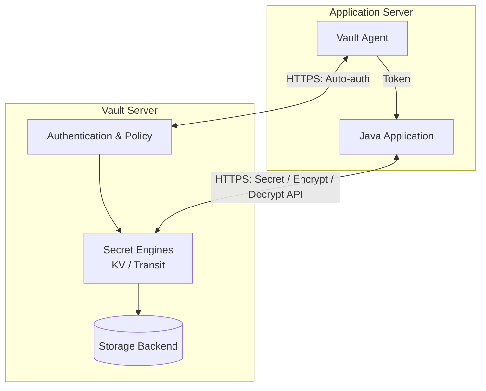
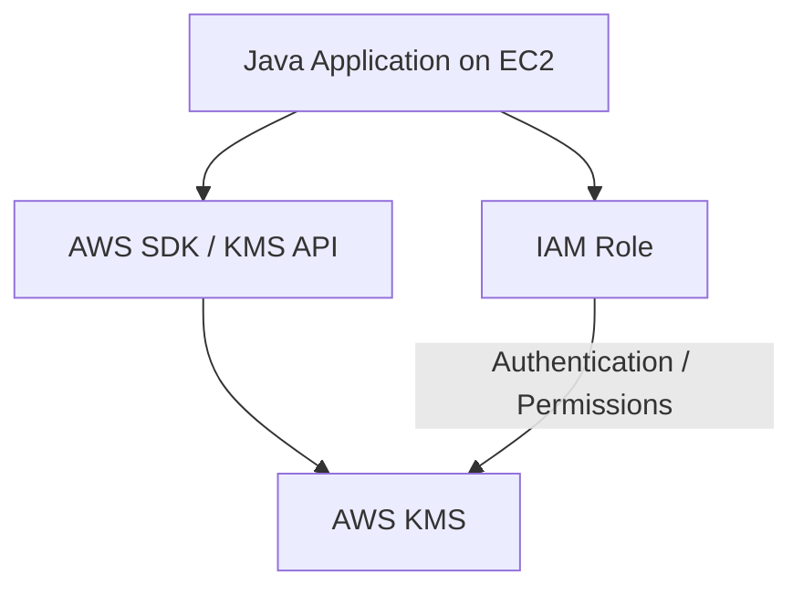
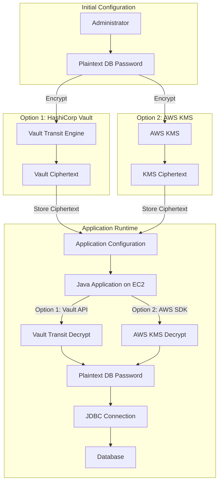

# 2026-11-25

# Today's Focus: Secret Management - HashiCorp Vault and AWS KMS

## HashiCorp Vault

HashiCorp Vault is a centralized secrets management platform used to store, protect, and manage sensitive information.It also provides encryption and decryption services through its Transit Secret Engine.

### Architecture



### Common Components

| Component      | Description                                            |
|----------------|--------------------------------------------------------|
| Vault Server   | Centralized secrets management and encryption service. |
| Vault Agent    | Handles automatic authentication and token renewal.    |
| KV Engine      | Stores passwords, API keys and application secrets.    |
| Transit Engine | Provides encryption and decryption services.           |

## AWS Key Management Service (KMS)

AWS KMS is a managed service used to create, manage, and protect encryption keys.

### Architecture



### AWS KMS Key Rotation

Key Rotation means changing the key material associated with a KMS Key.

For eligible customer-managed symmetric keys using AWS-generated key material, AWS KMS supports automatic key material rotation.

### Example: Database Password Encryption and Decryption Workflow



## Troubleshooting Scenarios

### Scenario 1: Vault Transit Encryption Fails

**Problem:**

A Java application uses Vault Transit Engine to encrypt a database password, but the encryption request fails.

Error message:

```text
Error writing data to transit/encrypt/db-password:

Code: 403

Errors:
* permission denied
```

**Investigation**

**Step 1: Check Vault Service Status**

```bash
vault status
```

Expected result:

```text
Initialized: true
Sealed: false
```

Verify that Vault is initialized and unsealed.

**Step 2: Check Transit Engine Configuration**

```bash
vault secrets list
```

Expected result:

```text
Path          Type
----          ----
transit/      transit
```

Verify that the Transit Engine is enabled.

**Step 3: Check Encryption Key**

```bash
vault list transit/keys
```

Expected result:

```text
Keys
----
db-password
```

Verify that the required encryption key exists.

**Step 4: Check Token Permissions**

```bash
vault token capabilities transit/encrypt/db-password
```

Expected result:

```text
update
```

Verify that the application token has permission to perform encryption.

**Step 5: Test Encryption Manually**

```bash
PLAINTEXT_B64=$(printf '%s' 'ExampleDBPassword' | base64 | tr -d '\n')

vault write -field=ciphertext transit/encrypt/db-password \
  plaintext="$PLAINTEXT_B64"
```

Expected result:

```text
vault:v1:xxxxxxxxxxxxxxxx
```

Verify that Vault successfully returns ciphertext.

**Possible Causes:**

- Transit Engine is not enabled.
- Encryption key does not exist.
- Application token does not have the required permissions.
- Incorrect encryption key name or API path.
- Vault is sealed or unavailable.
- Network connectivity or TLS validation fails.

**Resolution:**

- Enable the Transit Secret Engine.
- Create the required encryption key.
- Grant the application token the required Transit permissions.
- Verify the encryption key name and API path.
- Check Vault service availability.
- Verify network connectivity and TLS certificates.

**Verify:**

```bash
vault write -field=ciphertext transit/encrypt/db-password \
  plaintext=$(printf '%s' 'ExampleDBPassword' | base64 | tr -d '\n')
```

Expected result:

```text
vault:v1:xxxxxxxxxxxxxxxx
```

Vault successfully encrypts the database password and returns ciphertext.

Note: Use a secure input method for real production passwords instead of placing plaintext directly in shell commands or shell history.

### Scenario 2: AWS KMS AccessDeniedException

**Problem:**

A Java application running on an EC2 instance attempts to decrypt a database password using AWS KMS, but the request fails.

Error message:

```text
An error occurred (AccessDeniedException)

when calling the Decrypt operation:

User is not authorized to perform:
kms:Decrypt
```

**Investigation**

**Step 1: Check the Current AWS Identity**

```bash
aws sts get-caller-identity
```

Expected result:

```json
{
    "UserId": "EXAMPLE",
    "Account": "123456789012",
    "Arn": "arn:aws:sts::123456789012:assumed-role/AppRole/session"
}
```

Verify that the EC2 application is using the expected IAM Role.

**Step 2: Check KMS Key Status**

```bash
aws kms describe-key \
  --key-id alias/prod-db-password \
  --region ap-southeast-1
```

Expected result:

```text
KeyState: Enabled
KeyUsage: ENCRYPT_DECRYPT
KeySpec: SYMMETRIC_DEFAULT
```

Verify that the KMS key exists and is enabled.

**Step 3: Check IAM Permissions**

Verify that the application IAM Role has the required permission:

```text
kms:Decrypt
```

**Step 4: Check KMS Key Policy**

```bash
aws kms get-key-policy \
  --key-id alias/prod-db-password \
  --policy-name default \
  --region ap-southeast-1
```

Review the Key Policy and verify that the application IAM Role is authorized to use the key.

**Possible Causes:**

- IAM Role does not have `kms:Decrypt`.
- KMS Key Policy does not authorize the application principal.
- Application is using the wrong IAM Role.
- KMS key is disabled or unavailable.
- Incorrect AWS Region or KMS Key ID.
- Application is using long-term credentials instead of the intended IAM Role.

**Resolution:**

- Attach the appropriate IAM Policy.
- Update the KMS Key Policy if required.
- Verify that the EC2 instance uses the correct IAM Role.
- Ensure the KMS key is enabled.
- Check the AWS Region and KMS Key ID.
- Avoid using long-term AWS Access Keys in application configuration.

**Verify:**

```bash
aws kms decrypt \
  --ciphertext-blob fileb://db-password-encrypted.bin \
  --key-id alias/prod-db-password \
  --region ap-southeast-1
```

Expected result:

```text
KeyId: arn:aws:kms:ap-southeast-1:123456789012:key/...
Plaintext: <Base64-encoded plaintext>
```

Confirm that KMS successfully decrypts the database password.

### Scenario 3: Application Cannot Decrypt Data After AWS KMS Key Rotation

**Problem:**

A Java application running on EC2 cannot decrypt its database password using AWS KMS after a key rotation or key configuration change.

Error message:

```text
An error occurred (InvalidCiphertextException)
when calling the Decrypt operation:

The ciphertext or encryption context is invalid.
```

**Investigation**

**Step 1: Check KMS Key Status**

```bash
aws kms describe-key \
  --key-id alias/prod-db-password \
  --region ap-southeast-1
```

Expected result:

```text
KeyState: Enabled
KeyUsage: ENCRYPT_DECRYPT
KeySpec: SYMMETRIC_DEFAULT
```

Verify that the original KMS Key exists and is enabled.

**Step 2: Check Key Rotation Status**

```bash
aws kms get-key-rotation-status \
  --key-id alias/prod-db-password \
  --region ap-southeast-1
```

Expected result:

```json
{
    "KeyRotationEnabled": true
}
```

Verify that automatic key rotation is configured correctly.

**Step 3: Check IAM Permissions**

```bash
aws sts get-caller-identity
```

Verify that the EC2 application is using the expected IAM Role.

Check that the IAM Role has:

```text
kms:Decrypt
```

Also review the KMS Key Policy to ensure that the application role is authorized to use the key.

**Step 4: Verify Ciphertext and Encryption Context**

Check that the ciphertext stored in the application configuration has not been modified or truncated.

If an Encryption Context was specified during encryption, verify that the same key-value pairs are supplied during decryption.

Example:

```text
Application = payments
Environment = production
```

Encryption and decryption must use the same Encryption Context.

**Step 5: Test Decryption**

```bash
aws kms decrypt \
  --ciphertext-blob fileb://db-password-encrypted.bin \
  --key-id alias/prod-db-password \
  --region ap-southeast-1 \
  --query KeyId \
  --output text
```

If an Encryption Context was used, add the corresponding `--encryption-context` parameter.

Expected result:

```text
arn:aws:kms:ap-southeast-1:123456789012:key/xxxxxxxx
```

Verify that the Decrypt operation succeeds without exposing the plaintext password in terminal output.

**Possible Causes:**

- Original KMS Key is disabled or pending deletion.
- Application IAM Role does not have `kms:Decrypt` permission.
- KMS Key Policy does not authorize the application.
- Incorrect AWS Region or KMS Key ID.
- Ciphertext is corrupted or truncated.
- Encryption Context does not match.
- Application is using ciphertext encrypted with a different KMS Key.
- A new KMS Key was created during manual key rotation, but the original key is no longer available.

**Resolution:**

- Re-enable the original KMS Key if it was disabled.
- Grant the application IAM Role the required `kms:Decrypt` permission.
- Update the KMS Key Policy if necessary.
- Verify the original KMS Key ID and AWS Region.
- Restore the original ciphertext if it was modified.
- Ensure the Encryption Context matches the original encryption request.
- Keep the original KMS Key enabled when migrating to a new KMS Key.
- Use AWS KMS ReEncrypt to migrate ciphertext to another KMS Key when required.

**Verify:**

Retry the Decrypt operation using the correct KMS Key, IAM Role and Encryption Context.

Expected result:

```text
Decryption successful.
```

Confirm that the application retrieves the original database password and successfully establishes a JDBC connection.
