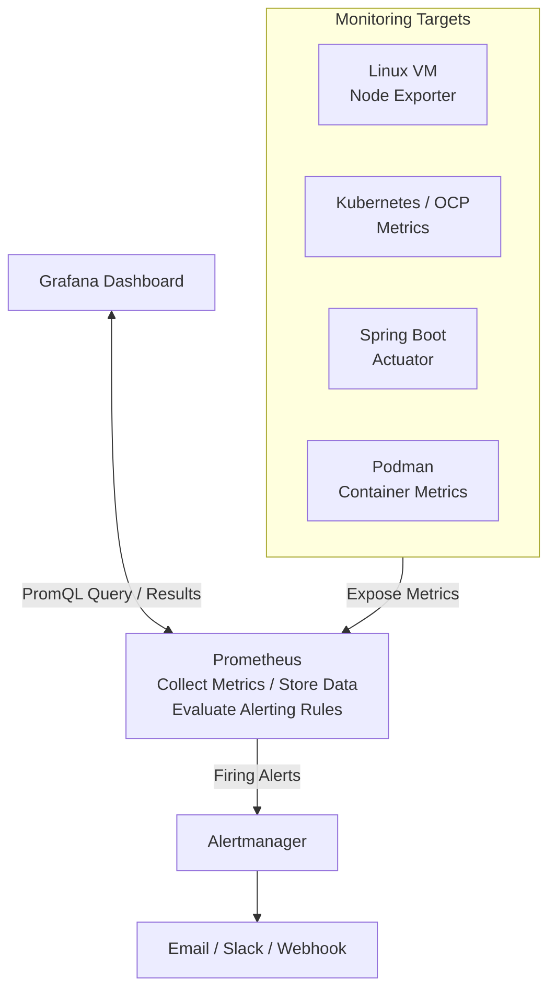

# 2026-11-26

# Today's Focus: Observability and Monitoring - Prometheus and Grafana

## Architecture

- **Prometheus**: Collects, stores, and queries metrics from infrastructure and applications.

- **Grafana**: Visualizes metrics through dashboards and provides alerting capabilities.

- **Alertmanager:** Handles alerts generated by Prometheus and manages notification routing.



## Troubleshooting Scenarios

### Scenario 1: Prometheus Cannot Scrape an Exporter

**Problem:**

Prometheus cannot collect metrics from a Linux server because the Node Exporter endpoint is unavailable.

Target status shows:

```text
job="node-exporter"
health="down"
lastError="connection refused"
```

**Investigation**

**Step 1: Check Prometheus Target Status**

Open the Prometheus Targets page:

```text
http://localhost:9090/targets
```

Or query the Targets API:

```bash
curl -s http://localhost:9090/api/v1/targets
```

Expected result:

```text
job: node-exporter
instance: 10.0.1.10:9100
health: down
lastError: connection refused
```

Verify that the affected target is marked as `DOWN` and identify the scrape error.

**Step 2: Check Node Exporter Service**

```bash
systemctl status node_exporter
```

Expected result:

```text
Active: active (running)
```

Verify that Node Exporter is running on the target server.

**Step 3: Check Exporter Listening Port**

```bash
ss -lntp | grep 9100
```

Expected result:

```text
LISTEN 0 4096 0.0.0.0:9100 0.0.0.0:*
```

Verify that Node Exporter is listening on the expected port.

**Step 4: Test Local Metrics Endpoint**

```bash
curl -v http://localhost:9100/metrics
```

Expected result:

```text
HTTP/1.1 200 OK
Content-Type: text/plain

# HELP node_cpu_seconds_total ...
node_cpu_seconds_total{...} ...
```

Verify that the Exporter successfully exposes Prometheus metrics.

**Step 5: Check Firewall and Remote Connectivity**

```bash
firewall-cmd --list-all

curl -v --connect-timeout 5 \
  http://10.0.1.10:9100/metrics
```

Expected result:

```text
Connected to 10.0.1.10
HTTP/1.1 200 OK
```

Verify that Prometheus can reach the Exporter endpoint over TCP port 9100.

**Possible Causes:**

- Node Exporter service is stopped.
- Exporter port is not listening.
- Firewall blocks the connection.
- Incorrect target address or port in `prometheus.yml`.
- Network routing or security rules prevent connectivity.
- Exporter is listening only on an inaccessible network interface.

**Resolution:**

- Start or restart Node Exporter if the service is stopped.
- Ensure Node Exporter listens on the expected network interface and port.
- Allow TCP port 9100 from the Prometheus server through the firewall.
- Correct the target address and port in `prometheus.yml`.
- Verify network routing and security rules.

Example:

```bash
systemctl restart node_exporter

firewall-cmd --permanent --add-port=9100/tcp
firewall-cmd --reload
```

Note: In production, restrict access to port 9100 to the Prometheus server IP instead of allowing access from all sources.

If the Prometheus target configuration is changed:

```bash
promtool check config prometheus.yml

curl -X POST http://localhost:9090/-/reload
```

Note: The HTTP reload endpoint requires Prometheus to be started with `--web.enable-lifecycle`. Otherwise, use the configured service reload mechanism or restart Prometheus.

**Verify:**

```promql
up{job="node-exporter"}
```

Expected result:

```text
10.0.1.10:9100    1
```

- Confirm that the target status changes from `DOWN` to `UP`.
- Verify that the `up` metric returns `1`.
- Confirm that Node Exporter metrics are available in Prometheus.

### Scenario 2: Grafana Dashboard Displays No Data

**Problem:**

A Grafana dashboard displays `No data` even though Prometheus is running. The dashboard panels cannot display the expected infrastructure or application metrics.

**Investigation**

**Step 1: Check Prometheus Service Health**

```bash
curl http://localhost:9090/-/healthy

curl http://localhost:9090/-/ready
```

Expected result:

```text
Prometheus is Healthy.
Prometheus is Ready.
```

Verify that Prometheus is running and ready to handle API requests.

**Step 2: Query Metrics Directly from Prometheus**

```bash
curl -G http://localhost:9090/api/v1/query \
  --data-urlencode 'query=up'
```

Expected result:

```text
{
  "status": "success",
  "data": {
    "resultType": "vector",
    "result": [
      {
        "metric": {
          "job": "node-exporter",
          "instance": "10.0.1.10:9100"
        },
        "value": [timestamp, "1"]
      }
    ]
  }
}
```

Verify that Prometheus successfully returns the expected metrics.

If the result is empty, check whether the required monitoring target is being scraped and whether the requested metric exists.

**Step 3: Verify the Required Metric Exists**

```bash
curl -G http://localhost:9090/api/v1/query \
  --data-urlencode \
  'query=node_memory_MemAvailable_bytes'
```

Expected result:

```text
status: success
resultType: vector
metric: node_memory_MemAvailable_bytes
```

Verify that the metric required by the Grafana dashboard exists in Prometheus.

**Step 4: Check Grafana Data Source Configuration**

Open Grafana:

```text
Connections
    |
    v
Data Sources
    |
    v
Prometheus
```

Check the following configuration:

```text
Data Source: Prometheus

URL: http://localhost:9090
```

Select **Save & test**.

Expected result:

```text
Successfully queried the Prometheus API.
```

Verify that Grafana can successfully connect to Prometheus.

**Step 5: Check Grafana Query and Dashboard Time Range**

Open Grafana Explore and execute:

```promql
up
```

Then check the dashboard configuration:

- Verify the PromQL query.
- Check metric names and label filters.
- Check dashboard variables.
- Adjust the dashboard time range, such as `Last 5 minutes` or `Last 1 hour`.

Expected result:

```text
Query Result:

instance                  Value
10.0.1.10:9100            1
```

Verify that the query returns data in Grafana Explore.

**Possible Causes:**

- Incorrect Prometheus data source URL.
- Grafana cannot establish network connectivity to Prometheus.
- PromQL query references a non-existent metric.
- Prometheus does not have the required metrics.
- Incorrect dashboard time range.
- Dashboard variables or label filters exclude all matching results.

**Resolution:**

- Correct the Prometheus Data Source URL in Grafana.
- Verify network connectivity between Grafana and Prometheus.
- Correct the PromQL query and metric names.
- Confirm that the required metrics are available in Prometheus.
- Adjust the dashboard time range.
- Review dashboard variables and label filters.

**Verify:**

```bash
curl -G http://localhost:9090/api/v1/query \
  --data-urlencode 'query=up'
```

Then:

1. Confirm that Prometheus returns the expected metrics.
2. Open Grafana Explore and execute the same PromQL query.
3. Confirm that Grafana successfully displays the query results.
4. Reopen the dashboard and verify that the panels display the expected monitoring data.

Grafana successfully retrieves and visualizes metrics from Prometheus.
