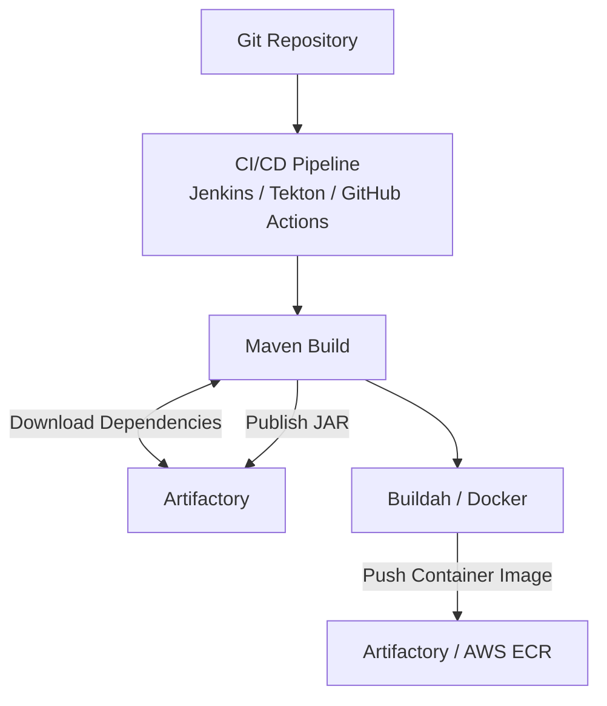

# 2026-11-27

# Today's Focus: Artifact Management - JFrog Artifactory and AWS ECR

## Architecture

- **Artifactory**: Supports multiple repository formats, including Maven, npm, Docker, and PyPI, for storing and managing software packages and artifacts such as JAR, WAR, and container images.


- **AWS ECR**: Primarily focuses on storing and managing container images.



## Troubleshooting Scenarios

### Scenario 1: Maven Dependency Download Fails

**Problem:**

A Java application fails during Maven dependency resolution because Artifactory rejects the request.

Error message:

```text
Could not transfer artifact

Status code: 401
Unauthorized
```

**Investigation**

**Step 1: Check Artifactory Availability**

```bash
curl https://artifactory.example.com/artifactory/api/system/ping
```

Expected result:

```text
OK
```

Verify that Artifactory is reachable.

**Step 2: Check Maven Repository Configuration**

```bash
grep -A 5 "company-maven" ~/.m2/settings.xml
```

Verify:

- Repository URL.
- Username and access token.
- Repository ID configuration.
- Mirror configuration.

**Step 3: Test Repository Access**

```bash
curl -I \
  -H "Authorization: Bearer $ARTIFACTORY_TOKEN" \
  "https://artifactory.example.com/artifactory/maven-virtual/<artifact-path>"
```

Expected result:

```text
HTTP/1.1 200 OK
```

Verify that the required artifact can be accessed.

**Step 4: Check Maven Dependency Resolution**

```bash
mvn -U dependency:resolve
```

Expected result:

```text
BUILD SUCCESS
```

**Possible Causes:**

- Incorrect repository URL.
- Missing or expired access token.
- Incorrect Maven repository ID.
- Insufficient Read permission.
- Required artifact does not exist.

**Resolution:**

- Correct the repository URL.
- Renew the access token.
- Verify Maven authentication configuration.
- Grant the required Read permission.
- Confirm the artifact coordinates and version.

**Verify:**

```bash
mvn -U clean package
```

Expected result:

```text
BUILD SUCCESS
```

Confirm that Maven successfully resolves dependencies.

### Scenario 2: Artifact Deployment Fails

**Problem:**

A CI/CD pipeline successfully builds a JAR file, but cannot upload the artifact to Artifactory.

Error message:

```text
Failed to execute goal
maven-deploy-plugin

Return code is: 403
Forbidden
```

**Investigation**

**Step 1: Check Generated Artifact**

```bash
ls -lh target/*.jar
```

Expected result:

```text
target/payment-service-1.0.0.jar
```

Verify that the JAR was successfully generated.

**Step 2: Check Deployment Repository**

Review the `distributionManagement` configuration in `pom.xml`.

Verify:

- Repository URL.
- Repository ID.
- Target Local Repository.

**Step 3: Check Authentication**

Verify that the repository ID in `pom.xml` matches the corresponding server ID in Maven `settings.xml`.

**Step 4: Check Repository Permissions**

Verify that the CI/CD service account has:

```text
Read Permission
Deploy / Write Permission
```

**Possible Causes:**

- CI/CD account lacks Deploy permission.
- Invalid username or access token.
- Incorrect repository URL.
- Repository ID mismatch.
- Artifact is being uploaded to a Virtual Repository.
- Release or Snapshot repository restrictions.

**Resolution:**

- Grant the required Deploy permission.
- Renew authentication credentials.
- Correct the deployment URL.
- Match the Maven repository IDs.
- Use a Local Repository as the deployment destination.
- Verify Release and Snapshot repository policies.

**Verify:**

```bash
mvn deploy
```

Expected result:

```text
BUILD SUCCESS
```

Confirm that the JAR is available in the Artifactory repository.

### Scenario 3: Kubernetes / OCP Cannot Pull a Private Image

**Problem:**

A Kubernetes / OCP Pod enters `ImagePullBackOff` because it cannot download a private container image from Artifactory / ECR.

Error message:

```text
Failed to pull image

unauthorized: authentication required
```

**Investigation**

**Step 1: Check Pod Status**

```bash
oc get pods -n production
```

Expected result:

```text
NAME                READY   STATUS
payment-service     0/1     ImagePullBackOff
```

**Step 2: Check Pod Events**

```bash
oc describe pod payment-service \
  -n production
```

Check the Events section for:

```text
Failed to pull image
Back-off pulling image
```

Identify whether the failure is related to authentication, image availability, or connectivity.

**Step 3: Check Image Reference**

Verify:

- Registry hostname.
- Repository name.
- Image tag.
- Image availability.

For ECR, also confirm the AWS Account ID and Region.

**Step 4: Check Image Pull Secret**

```bash
oc get serviceaccount default \
  -n production -o yaml

oc get secrets -n production
```

Expected result:

```yaml
imagePullSecrets:
  - name: registry-secret
```

Verify that the required registry credentials are associated with the ServiceAccount or Pod.

**Step 5: Check Registry Permissions**

For Artifactory:

- Verify Read / Pull permission.
- Verify registry credentials.
- Verify TLS certificate trust.

For ECR:

- Verify IAM authentication and ECR pull permissions.
- Check the ECR Repository Policy when cross-account access is involved.
- Check whether the registry token has expired.

**Possible Causes:**

- ImagePullSecret is missing or invalid.
- ECR authentication token has expired.
- Incorrect image URL or tag.
- Insufficient registry Read permission.
- AWS IAM Role lacks ECR pull permissions.
- Image does not exist.
- OCP nodes cannot reach the registry.
- TLS certificate validation fails.

**Resolution:**

- Create or update the registry ImagePullSecret.
- Configure valid registry credentials.
- Attach the secret to the correct ServiceAccount or Pod.
- Renew expired ECR credentials.
- Grant the required Artifactory or AWS IAM permissions.
- Correct the image URL and tag.
- Verify network connectivity and TLS certificates.

**Verify:**

```bash
oc rollout restart deployment/payment-service \
  -n production

oc rollout status deployment/payment-service \
  -n production

oc get pods -n production
```

Expected result:

```text
NAME                READY   STATUS
payment-service     1/1     Running
```

Confirm that the Pod successfully pulls the image and reaches the Ready state.
