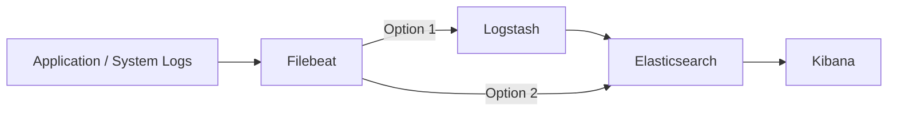

# 2026-11-28

# Today's Focus: Logs Management - ELK Stack

## Architecture

- **Elasticsearch**: Stores, indexes, and searches log data.
- **Logstash**: Collects, processes, and forwards log data.
- **Kibana**: Provides dashboards and visualizes log data.
- **Filebeat**: A lightweight log shipper that collects log files and sends them to Logstash or Elasticsearch.



## Troubleshooting Scenarios

### Scenario 1: Filebeat Cannot Send Logs to Logstash

**Problem:**

Filebeat cannot forward application logs to Logstash. As a result, new log entries are not appearing in Elasticsearch or Kibana.

Filebeat logs show:

```text
Failed to connect to backoff(async(tcp://10.0.1.20:5044)):
dial tcp 10.0.1.20:5044: connect: connection refused
```

**Investigation**

**Step 1: Check Filebeat Service Status**

```bash
systemctl status filebeat
```

Expected result:

```text
Active: active (running)
```

Verify that Filebeat is running on the application server.

**Step 2: Validate Filebeat Configuration**

```bash
filebeat test config -e
```

Expected result:

```text
Config OK
```

Verify that the Filebeat configuration has no syntax errors.

**Step 3: Check Logstash Service Status**

```bash
systemctl status logstash
```

Expected result:

```text
Active: active (running)
```

Verify that Logstash is running on the log processing server.

**Step 4: Check Logstash Listening Port**

```bash
ss -lntp | grep 5044
```

Expected result:

```text
LISTEN 0 4096 0.0.0.0:5044 0.0.0.0:*
```

Verify that Logstash is listening on TCP port 5044 for incoming Beats connections.

**Step 5: Test Remote Connectivity**

Run the following command on the Filebeat server:

```bash
nc -zv 10.0.1.20 5044
```

Expected result:

```text
Connection to 10.0.1.20 5044 port [tcp/*] succeeded!
```

Verify that the Filebeat server can establish a TCP connection to Logstash.

**Step 6: Test Filebeat Output**

```bash
filebeat test output
```

Expected result:

```text
logstash: 10.0.1.20:5044...
  connection...
  parse host... OK
  dial up... OK
  handshake... OK
```

Verify that Filebeat can successfully connect to Logstash.

**Possible Causes:**

- Filebeat service is stopped.
- Logstash service is unavailable.
- Logstash is not listening on the expected port.
- Incorrect Logstash host or port in Filebeat configuration.
- Firewall blocks TCP port 5044.
- Network routing or connectivity issues.
- Filebeat and Logstash use incompatible SSL/TLS configurations.

**Resolution:**

- Start or restart Filebeat and Logstash if their services are unavailable.
- Verify the `output.logstash` configuration in `filebeat.yml`.
- Ensure Logstash has a Beats input configured on the expected port.
- Allow TCP port 5044 between the Filebeat and Logstash servers.
- Verify network routing and SSL/TLS settings.

Example Filebeat configuration:

```yaml
output.logstash:
  hosts: ["10.0.1.20:5044"]
```

Example Logstash input configuration:

```ruby
input {
  beats {
    port => 5044
  }
}
```

Restart the services after configuration changes:

```bash
systemctl restart logstash
systemctl restart filebeat
```

**Validation:**

```bash
filebeat test output

journalctl -u filebeat -n 50 --no-pager
```

Expected: Filebeat successfully connects to Logstash without repeated connection errors, and new log events are forwarded.

---

### Scenario 2: Logstash Pipeline Fails to Start

**Problem:**

Logstash fails to start because of an invalid pipeline configuration.

Logstash logs show:

```text
Error: Failed to execute action
Pipeline aborted due to configuration error
```

**Investigation**

**Step 1: Check Logstash Service Status**

```bash
systemctl status logstash
```

Expected result:

```text
Active: failed (Result: exit-code)
```

Verify that the Logstash service has failed to start.

**Step 2: Validate Logstash Configuration**

```bash
/usr/share/logstash/bin/logstash \
  --path.settings /etc/logstash -t
```

Expected result:

```text
Configuration OK
```

If the configuration is invalid, Logstash reports the corresponding configuration error and file location.

Verify that all pipeline configuration files have valid syntax.

**Step 3: Check Logstash Service Logs**

```bash
journalctl -u logstash -n 50 --no-pager
```

Alternatively:

```bash
tail -n 50 /var/log/logstash/logstash-plain.log
```

Expected result:

```text
[ERROR][logstash.agent] Failed to execute action
[ERROR][logstash.javapipeline] Pipeline aborted
```

Verify the error message and identify which pipeline or configuration file caused the failure.

**Step 4: Check Pipeline Configuration Files**

```bash
ls -l /etc/logstash/conf.d/
```

Expected result:

```text
-rw-r--r-- 1 root root  1200 input.conf
-rw-r--r-- 1 root root   800 filter.conf
-rw-r--r-- 1 root root   600 output.conf
```

Verify that the expected pipeline configuration files exist and are accessible to Logstash.

**Possible Causes:**

- Invalid Logstash pipeline syntax.
- Missing or incorrect input, filter, or output configuration.
- Required Logstash plugins are not installed.
- Incorrect file permissions.
- Invalid Elasticsearch output configuration.
- Conflicting or duplicate pipeline settings.

**Resolution:**

- Correct syntax errors in the pipeline configuration files.
- Verify input, filter, and output settings.
- Install missing Logstash plugins if required.
- Ensure Logstash can access the configuration files.
- Verify the Elasticsearch host, port, and authentication settings.

Example pipeline configuration:

```ruby
input {
  beats {
    port => 5044
  }
}

filter {
  # Add log processing rules here
}

output {
  elasticsearch {
    hosts => ["http://10.0.1.30:9200"]
    index => "application-logs"
  }
}
```

Restart Logstash after correcting the configuration:

```bash
systemctl restart logstash
```

**Validation:**

```bash
systemctl status logstash

journalctl -u logstash -n 50 --no-pager
```

Expected: Logstash is running, and the pipeline starts without configuration errors.

---

### Scenario 3: Elasticsearch Index Becomes Read-Only

**Problem:**

Logstash cannot write new log events to Elasticsearch because the affected index has become read-only.

Logstash logs show:

```text
cluster_block_exception:
index [application-logs] blocked by:
[FORBIDDEN/12/index read-only / allow delete (api)]
```

**Investigation**

**Step 1: Check Elasticsearch Cluster Health**

```bash
curl -s \
  "http://localhost:9200/_cluster/health?pretty"
```

Expected result:

```json
{
  "cluster_name": "elasticsearch",
  "status": "yellow",
  "number_of_nodes": 3
}
```

Verify the cluster health and identify whether the cluster has any availability issues.

Note: The cluster may report `green`, `yellow`, or `red`. Cluster health alone does not confirm the cause of the read-only index.

**Step 2: Check Elasticsearch Disk Usage**

```bash
curl -s \
  "http://localhost:9200/_cat/allocation?v&h=node,disk.percent,disk.avail,disk.total"
```

Expected result:

```text
node       disk.percent  disk.avail  disk.total
es-node-1  96            3.5gb       100gb
es-node-2  75            25gb        100gb
es-node-3  70            30gb        100gb
```

Verify whether any Elasticsearch node is running low on disk space.

**Step 3: Check Index Read-Only Settings**

```bash
curl -s \
  "http://localhost:9200/application-logs/_settings?pretty"
```

Expected result:

```json
{
  "application-logs": {
    "settings": {
      "index": {
        "blocks": {
          "read_only_allow_delete": "true"
        }
      }
    }
  }
}
```

Verify whether the affected index has the `read_only_allow_delete` setting enabled.

**Step 4: Check Elasticsearch Server Disk Space**

```bash
df -h
```

Expected result:

```text
Filesystem      Size  Used  Avail  Use%
/dev/sdb1       100G   96G  4.0G   96%
```

Verify whether the filesystem storing Elasticsearch data has insufficient free space.

**Possible Causes:**

- Elasticsearch disk usage reaches the flood-stage watermark.
- Insufficient disk space on Elasticsearch data nodes.
- Large volumes of historical logs consume storage.
- Index retention or lifecycle policies are not properly configured.

**Resolution:**

- Free up disk space by removing obsolete or unnecessary data.
- Increase the storage capacity of Elasticsearch data nodes if required.
- Configure Index Lifecycle Management (ILM) to manage log retention.
- Wait until disk usage falls below the applicable high watermark.
- If the read-only block remains, remove it manually from the affected indices.

Example:

```bash
curl -X PUT \
  "http://localhost:9200/application-logs/_settings" \
  -H "Content-Type: application/json" \
  -d '{
    "index.blocks.read_only_allow_delete": null
  }'
```

**Validation:**

Check the index settings again:

```bash
curl -s \
  "http://localhost:9200/application-logs/_settings?pretty"
```

Expected: The `read_only_allow_delete` setting is no longer enabled.

Test whether Elasticsearch can accept new documents:

```bash
curl -X POST \
  "http://localhost:9200/application-logs/_doc" \
  -H "Content-Type: application/json" \
  -d '{
    "message": "ELK write test",
    "level": "INFO"
  }'
```

Expected result:

```json
{
  "result": "created",
  "_index": "application-logs"
}
```

Verify that Elasticsearch successfully accepts new documents and Logstash can resume indexing log events.
